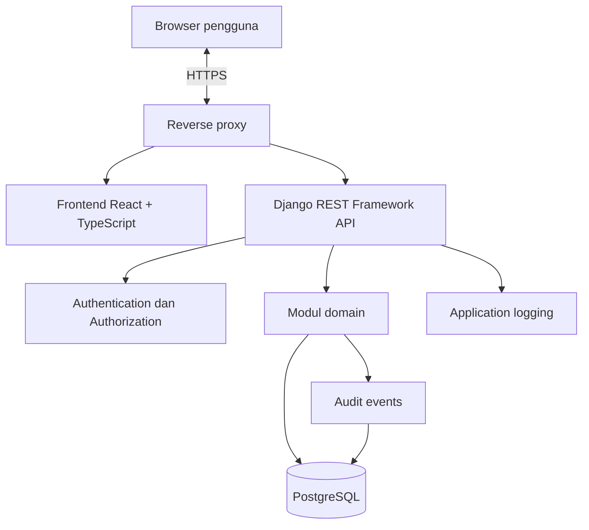

# NetLab Manager — Design Document

**Versi:** 1.3
**Tanggal:** 25 Oktober 2026
**Status:** Draft desain untuk validasi

Hierarki dokumen: lihat `prd.md`. Dokumen ini menentukan rancangan; `spec.md` menentukan persyaratan teknis; `docs/` merinci kontrak.

## 1. Prinsip Desain

1. **Operational clarity:** pengguna dapat memahami kondisi dan data laboratorium tanpa menebak.
2. **Data integrity first:** validasi dan aturan bisnis ditegakkan di backend/database.
3. **Least privilege:** setiap peran hanya memperoleh izin minimum yang dibutuhkan.
4. **Progressive scope:** MVP mengelola dokumentasi; integrasi otomatis menjadi fase terpisah.
5. **Traceability:** perubahan penting dapat ditelusuri.
6. **Simple deployment:** hindari kompleksitas infrastruktur yang belum dibutuhkan.

## 2. Ruang Lingkup Desain

NetLab Manager adalah aplikasi web untuk inventaris aset, IPAM, VLAN, dokumentasi koneksi, insiden, impor CSV, dan audit. Desain ini tidak mencakup network discovery otomatis, remote command execution, monitoring real-time, atau multi-VRF.

## 3. Arsitektur Tingkat Tinggi



Frontend dapat disajikan sebagai aset statis melalui reverse proxy. Reverse proxy meneruskan `/api/v1/` ke backend. Sebisa mungkin gunakan satu origin agar konfigurasi cookie, CSRF, dan CORS tidak menjadi rumit.

## 4. Modul Domain

Setiap modul domain berupa Django app tersendiri, kecuali Operations.

### Accounts

Mengelola identitas pengguna, status akun, peran (Django Groups), dan permission eksplisit.

### Locations

Mengelola lokasi fisik/logis (ruangan, rak, dan sejenisnya). Aplikasi backend tersendiri.

### Assets

Mengelola aset, kategori, status, metadata perangkat, dan interface perangkat.

### IPAM

Mengelola subnet dan alamat IP, termasuk validasi cakupan, larangan subnet overlap, dan konflik alokasi.

### VLANs

Mengelola identitas VLAN dan deskripsi penggunaannya. VLAN dapat dirujuk oleh subnet (relasi opsional) dan tidak dapat diarsipkan selama masih dirujuk subnet aktif.

### Connections

Mengelola relasi antarinterface sebagai pasangan tak berarah yang ternormalisasi. Satu interface hanya boleh memiliki satu koneksi aktif bertipe fisik (`ethernet`, `fiber`, `console`).

### Incidents

Mengelola tiket gangguan, severity, status, assignee, aset terkait opsional, dan riwayat event.

### Imports

Menangani impor CSV: parsing, validasi per baris, preview, dan commit atomik. Memakai service modul domain terkait; tidak menulis ke database secara langsung.

### Audit

Menyimpan catatan tindakan penting untuk penelusuran. Akses baca dibatasi; pengguna biasa tidak dapat mengubah atau menghapus audit event.

### Operations

Bukan aplikasi Django. Berupa konfigurasi dan prosedur di direktori `deployment/`: compose, reverse proxy, health check, migrasi, backup, restore, dan dokumentasi deployment.

## 5. Struktur Navigasi UI

Navigasi utama:

- Dashboard
- Assets
- Locations
- IPAM
  - Subnets
  - IP Addresses
- VLANs
- Connections
- Incidents
- Import CSV (peran yang berwenang)
- Audit Log (peran yang berwenang)
- User Management (administrator)

Interface perangkat dikelola dari halaman detail aset (tab Interfaces).

### Dashboard

Tampilkan ringkasan operasional dari endpoint ringkasan: jumlah aset, subnet, IP yang tercatat, insiden terbuka, dan perubahan terbaru. Angka harus berasal dari data aktual, bukan hard-coded. Bagian "perubahan terbaru" hanya muncul bagi pengguna yang berhak membaca audit.

### Daftar aset

Tampilkan nama, tipe, lokasi, status, dan aksi sesuai permission. Sediakan pencarian, filter, pagination, empty state, loading state, dan error state.

### Detail aset

Tampilkan identitas aset, lokasi, interface, alokasi IP, koneksi, serta insiden terkait. Data sensitif atau aksi administratif hanya ditampilkan kepada peran yang berwenang.

### IPAM

Tampilkan subnet, CIDR, gateway (informasi saja), VLAN terkait, dan daftar alokasi IP. Visualisasi penggunaan alamat dapat ditambahkan jika perhitungannya benar dan skalanya sesuai; jangan menyiratkan status jaringan aktif hanya dari data inventaris.

### Insiden

Tampilkan daftar berdasarkan status, severity, dan assignee. Detail insiden memiliki timeline event yang append-only bagi pengguna biasa dan menautkan aset terkait bila ada.

### Import CSV

Alur tiga langkah: pilih jenis data dan unggah file → preview (ringkasan dan tabel error per baris, tanpa menyimpan) → konfirmasi commit. Tombol commit nonaktif selama masih ada error. Sediakan tautan template CSV per jenis data. Template subnet memiliki kolom `vlan` berisi nomor VLAN yang sudah ada dan aktif; VLAN tidak dapat diimpor.

## 6. Design System dan UX

- Gunakan layout dashboard yang konsisten, sidebar yang dapat digunakan di layar kecil, dan header halaman yang jelas.
- Gunakan komponen bersama untuk tabel, form field, dialog konfirmasi, badge status, pagination, dan feedback error.
- Warna status harus disertai label teks; jangan mengandalkan warna saja.
- Form harus menjelaskan field wajib, format, dan alasan penolakan input.
- Tindakan destruktif membutuhkan konfirmasi dan permission backend.
- Hindari menampilkan secret, credential perangkat, atau data yang tidak diperlukan.
- Sediakan empty state yang menjelaskan langkah berikutnya.
- Pastikan navigasi keyboard, fokus terlihat, kontras memadai, dan label form dapat diakses.

## 7. Model Interaksi

### Membuat aset

1. Pengguna membuka Assets.
2. Memilih Add Asset.
3. Mengisi field yang wajib dan opsional.
4. Frontend memeriksa format dasar.
5. Backend memeriksa permission, validasi domain, dan constraint.
6. UI menampilkan hasil sukses atau error yang dapat ditindaklanjuti.

### Mengalokasikan alamat IP

1. Pengguna memilih subnet.
2. Memasukkan alamat IP.
3. Backend memvalidasi tipe alamat, cakupan subnet, kebijakan network/broadcast/gateway/reserved address.
4. Service mengunci baris subnet dalam transaksi; unique index dan trigger penjaga database menjadi pemeriksaan final.
5. Konflik dikembalikan sebagai error `409` terstruktur; frontend tidak mencoba menyelesaikan konflik secara diam-diam.

### Mencatat insiden

1. Pengguna membuat insiden (aset terkait opsional).
2. Sistem menetapkan status awal dan mencatat event.
3. Perubahan status/assignee menambahkan event.
4. Riwayat ditampilkan secara kronologis.

### Mengimpor CSV

1. Pengguna mengunggah file; frontend hanya memeriksa ukuran dan ekstensi.
2. Backend menjalankan preview dan mengembalikan ringkasan serta error per baris.
3. Pengguna memperbaiki file lalu mengunggah ulang, atau mengonfirmasi commit bila tidak ada error.
4. Backend memvalidasi ulang seluruh baris saat commit dan menyimpan dalam satu transaksi.

### Login dan CSRF

1. Frontend memanggil endpoint CSRF saat aplikasi dimuat dan menyimpan token di memori aplikasi.
2. Setiap request pengubah state mengirim token di header.
3. Login membuat session server-side; logout mengakhirinya.

## 8. Arsitektur Frontend

Gunakan React, TypeScript, dan Vite. Organisasikan kode berdasarkan fitur/domain.

Contoh struktur:

```text
frontend/src/
├── app/
├── components/
├── features/
│   ├── auth/
│   ├── dashboard/
│   ├── users/
│   ├── assets/
│   ├── locations/
│   ├── ipam/
│   ├── vlans/
│   ├── connections/
│   ├── incidents/
│   ├── imports/
│   └── audit/
├── lib/
└── types/
```

Ketentuan:

- Gunakan typed API client dan tipe request/response yang konsisten dengan OpenAPI.
- Pisahkan komponen presentasi dari logika domain yang kompleks.
- Tangani loading, empty, success, dan error state.
- Jangan menaruh aturan otorisasi hanya di frontend.
- Jangan menyimpan credential, token, atau secret di local storage.
- Gunakan library tambahan hanya jika memberi manfaat jelas.

## 9. Arsitektur Backend

Gunakan Django REST Framework dengan modular monolith. Setiap domain memiliki model, serializer, view/API, permission, service, dan test yang sesuai.

Ketentuan:

- Business rules tidak hanya berada di serializer atau frontend.
- Gunakan transaksi database untuk operasi multi-langkah.
- Gunakan constraint database untuk invariant yang harus selalu berlaku.
- Hindari query N+1 dengan pemuatan relasi yang tepat.
- Terapkan pagination (page-number) dan filter server-side.
- Pisahkan audit event dari log debug biasa.
- Terapkan throttling sesuai kebijakan di `spec.md`.
- Sediakan schema OpenAPI yang mengikuti endpoint aktual.

## 10. Desain Database

Entitas inti:

- User, Group (peran), Permission
- Location
- Asset
- NetworkInterface
- Subnet
- IPAddress
- VLAN
- Connection
- Incident
- IncidentEvent
- AuditEvent

Keputusan desain:

- Gunakan foreign key untuk relasi. Gunakan `inet` untuk alamat IP dan `cidr` untuk subnet.
- **Keunikan IP:** unik per `(subnet, address)` pada baris aktif. Karena subnet aktif tidak boleh overlap (exclusion constraint GiST dengan operator `&&` pada kolom `cidr`, dibatasi baris aktif), keunikan efektif berlaku untuk seluruh lab. Validasi bahwa alamat berada dalam subnetnya dilakukan di service dalam transaksi karena constraint database tidak dapat merujuk tabel lain tanpa trigger.
- **Arsip:** kolom `archived_at` pada entitas operasional; constraint unik dan exclusion bersifat parsial (`WHERE archived_at IS NULL`).
- **Koneksi:** pasangan tak berarah. Disimpan dengan `interface_a_id < interface_b_id` (CHECK), dengan unique constraint pada pasangan aktif.
- **Subnet–VLAN:** `subnet.vlan_id` adalah FK opsional ke VLAN aktif; satu VLAN dapat dirujuk banyak subnet.
- **Koneksi fisik:** satu interface hanya boleh memiliki satu koneksi aktif bertipe fisik. Ditegakkan lewat tabel klaim yang hanya diisi trigger, sehingga aman terhadap request bersamaan.
- **Penjaga integritas:** trigger database menolak relasi baru ke induk terarsip dan menolak pengarsipan induk yang masih memiliki anak aktif, dengan kunci baris induk agar aman terhadap penulisan bersamaan.
- Detail tabel, enum, indeks, dan constraint ada di `docs/DATA_MODEL.md`.

## 11. Keamanan

- Browser authentication menggunakan Django session dan CSRF protection.
- Cookie menggunakan pengaturan `HttpOnly`, `Secure` pada HTTPS, dan `SameSite` yang sesuai.
- HTTPS untuk akses jaringan.
- Permission diperiksa pada endpoint dan objek.
- Rate limiting untuk login dan endpoint berisiko.
- Database tidak diekspos ke jaringan pengguna.
- Aplikasi memakai role database runtime berhak minimum (tanpa hak pemilik tabel, tanpa `DELETE`/`TRUNCATE` pada data operasional, tanpa hak menonaktifkan trigger); migrasi dijalankan oleh role pemilik skema yang terpisah.
- Secret disimpan di environment/secret store, tidak di Git.
- Log tidak menyimpan password, token, cookie, private key, atau secret.
- Audit event mencatat aktor, aksi, objek, waktu, dan metadata aman.
- File CSV diproses dengan batas ukuran dan jumlah baris, dan tidak disimpan setelah impor.
- Backup dibatasi aksesnya dan dienkripsi sesuai risiko.
- Integrasi perangkat masa depan harus menggunakan akses minimum dan persetujuan eksplisit.

## 12. Deployment Design

Deployment awal:

- Linux server yang disetujui.
- Reverse proxy dengan HTTPS.
- Frontend statis.
- Django application server.
- PostgreSQL pada jaringan internal dengan dua role: pemilik skema (migrasi, backup/restore) dan runtime aplikasi.
- Compose untuk orkestrasi layanan.
- Volume persisten untuk data database.
- Backup terjadwal dan prosedur restore.

Jangan mengekspos port PostgreSQL ke publik. Jangan menghapus volume data saat rebuild. Verifikasi ketersediaan Docker Compose atau provider Podman Compose sebelum memulai fase implementasi.

## 13. Keputusan yang Perlu Dicatat sebagai ADR

Semua dicatat di `docs/ADR.md`.

- ADR-001: modular monolith, bukan microservices.
- ADR-002: React + TypeScript + Vite untuk frontend.
- ADR-003: Django REST Framework untuk backend.
- ADR-004: PostgreSQL sebagai database.
- ADR-005: session authentication untuk browser MVP.
- ADR-006: input manual dan impor CSV tervalidasi sebelum integrasi otomatis.
- ADR-007: Compose untuk deployment awal.
- ADR-008: tidak ada network scanning atau remote configuration pada MVP.
- ADR-009: keunikan IP per subnet disertai larangan subnet overlap; multi-VRF di luar MVP.
- ADR-010: arsip dengan `archived_at`, tanpa penghapusan fisik melalui UI/API.
- ADR-011: RBAC dengan Django Groups dan permission eksplisit.
- ADR-012: koneksi sebagai pasangan tak berarah ternormalisasi.
- ADR-013: impor CSV masuk MVP dengan preview dan commit atomik.
- ADR-014: pagination page-number, format error seragam, dan kebijakan rate limiting.
- ADR-015: `locations` sebagai aplikasi backend tersendiri.
- ADR-016: custom user model sejak migrasi pertama.
- ADR-017: satu koneksi aktif per interface fisik, ditegakkan lewat tabel klaim yang dikelola trigger.
- ADR-018: relasi opsional subnet–VLAN (`subnet.vlan_id`).
- ADR-019: trigger penjaga integritas arsip/relasi dan role database runtime berhak minimum.
- ADR-020: VLAN 1002–1005 ditolak; VLAN 1 diizinkan; gateway hanya informasi pada subnet.
- ADR-021: baseline PostgreSQL 16 dan Django 5.2 LTS; versi patch dan dependency dikunci pada Phase 0.
- ADR-022: nomor VLAN disimpan di `vlan_number`; `subnet.vlan` merujuk baris VLAN.

## 14. Kriteria Review Desain

Desain siap diimplementasikan ketika:

- semua modul MVP dan batasannya disepakati;
- model data dan constraint IPAM didefinisikan di `docs/DATA_MODEL.md`;
- role dan matriks permission tersedia di `docs/RBAC_MATRIX.md`;
- kontrak API inti terdokumentasi di `docs/API_SPEC.md`;
- alur UI untuk fitur utama ditetapkan;
- deployment dan secret handling terdokumentasi;
- setiap keputusan yang berisiko atau sulit diubah memiliki ADR dengan alasan tertulis.

## 15. Catatan Revisi 1.1

- Tambah modul Locations dan Imports; Operations dijelaskan sebagai direktori `deployment/`.
- Tambah halaman Import CSV, User Management, dan dashboard berbasis endpoint ringkasan.
- Tambah alur login/CSRF dan impor CSV.
- Perjelas keunikan IP, arsip, normalisasi koneksi, dan ADR-009 s.d. ADR-016.

## 16. Catatan Revisi 1.2

- Tambah relasi subnet–VLAN, aturan koneksi fisik, penjaga integritas database, dan kebijakan role database.
- Ganti `hostname/nama` menjadi `nama` pada daftar aset.
- Tambah ADR-017 s.d. ADR-020.

## 17. Catatan Revisi 1.3

- Tambah ADR-021 dan ADR-022; perjelas kolom `vlan` pada template CSV subnet.
