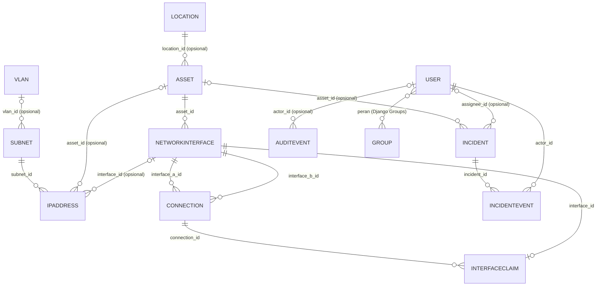

# NetLab Manager — Data Model

**Versi:** 1.2 (revisi setelah OD-11, OD-12, dan K-5 ditutup)
**Tanggal:** 25 Oktober 2026
**Sumber kebenaran:** `prd.md`, `design.md`, `spec.md` versi 1.3
**Status:** Dokumentasi saja. Tidak ada model Django, migrasi, atau kode aplikasi pada tahap ini.

## 1. Tujuan dan Kedudukan Dokumen

Dokumen ini merinci tabel, kolom, tipe, nullability, relasi, enum, constraint, indeks, aturan arsip, dan perilaku relasi untuk NetLab Manager MVP. Dokumen ini **merinci** keputusan v1.1 dan tidak menggantikannya. Jika ada pertentangan dengan `prd.md`, `design.md`, atau `spec.md`, dokumen utama menang dan pertentangan dilaporkan (lihat bagian 15).

Penanda yang dipakai:

- **D-xx**: keputusan yang sudah ditetapkan dokumen utama v1.3, termasuk hasil penutupan OD-01 s.d. OD-12 (bagian 12).
- **A-xx**: asumsi dokumen ini. A-01 s.d. A-20 sudah disetujui dengan syarat; statusnya ada di bagian 13.
- **OPEN DECISION (OD-xx)**: keputusan yang belum cukup jelas untuk skema yang aman. Dokumen ini memberi default sementara yang ditandai jelas; default tersebut tidak boleh dijadikan migrasi sebelum OD diputuskan. OD yang masih terbuka ada di bagian 14.

## 2. Konvensi Umum

| Kode | Konvensi |
| --- | --- |
| C-01 | Primary key `id` bertipe `bigint` identity (Django `BigAutoField`). Lihat A-01. |
| C-02 | Semua foreign key pada tabel aplikasi memakai `ON DELETE RESTRICT` (Django `PROTECT`). Tidak ada `CASCADE` atau `SET NULL` pada tabel aplikasi. Tabel framework (`auth_group`, `auth_user_groups`, `django_session`, dan sejenisnya) dikelola Django. |
| C-03 | `created_at` dan `updated_at` bertipe `timestamptz NOT NULL`, disimpan UTC (`USE_TZ=True`), ditampilkan dalam `TIME_ZONE` yang ditetapkan. `updated_at` dipelihara aplikasi (A-17). Pengecualian: `accounts_user` memakai `date_joined`/`last_login` bawaan Django; `incidents_incidentevent` hanya `created_at`; `audit_auditevent` memakai kolom `timestamp`. |
| C-04 | **Baris aktif** berarti `archived_at IS NULL`. Semua keunikan "di antara baris aktif" diwujudkan dengan partial unique index `WHERE archived_at IS NULL`. Daftar default hanya menampilkan baris aktif. |
| C-05 | Teks wajib: `NOT NULL` dan `btrim(kolom) <> ''`. Teks bebas opsional (`description`): `NOT NULL DEFAULT ''`. Identitas opsional (`manufacturer`, `model`, `serial_number`, `mac_address`): `NULL` bila tidak diisi, tidak pernah `''`. Lihat A-04. |
| C-06 | Keunikan nama tidak peka huruf besar/kecil memakai indeks `lower(kolom)`. Aplikasi men-trim spasi di tepi dan memadatkan spasi ganda sebelum menyimpan; huruf asli dipertahankan. Lihat A-03. |
| C-07 | Enum disimpan sebagai `varchar` dengan `CHECK (... IN (...))`, nilai `snake_case` bahasa Inggris, makna di bagian 4. Kolom enum **tidak** punya `DEFAULT` di database; service yang menetapkan nilai awal. Lihat A-02, A-14. |
| C-08 | Alamat IP bertipe `inet` dan harus berupa alamat host (mask penuh `/32` atau `/128`). Subnet bertipe `cidr` (PostgreSQL menolak bit host yang tidak nol). |
| C-09 | Pengurutan daftar selalu menyertakan `id` sebagai tie-breaker agar pagination deterministik. |
| C-10 | Nama constraint dan indeks mengikuti pola `<tabel>_<tujuan>_<chk\|uq\|fk\|idx>`. Pemetaan nama constraint ke kode error API ada di bagian 6.6, sehingga nama tidak boleh diubah sembarangan. |
| C-11 | Transaksi memakai isolation level `READ COMMITTED` (default Django). Trigger penjaga bergantung padanya: query dalam trigger harus melihat baris yang di-commit transaksi lain setelah menunggu kunci. `REPEATABLE READ` dan `SERIALIZABLE` tidak boleh dipakai tanpa kajian ulang. |
| C-12 | Urutan kunci baris: vlan → subnet → location → asset → interface. Saat mengarsipkan aset secara berantai, kunci aset lebih dulu, lalu interface-nya. Deadlock (`40P01`) diulang satu kali oleh aplikasi. |

## 3. Diagram Relasi



`INTERFACECLAIM` hanya diisi trigger untuk koneksi fisik aktif (5.12).

## 4. Enum

### 4.1 Peran (Django Groups)

| Nilai | Makna |
| --- | --- |
| `administrator` | Mengelola akun, peran, dan operasi administratif. |
| `lab_manager` | Mengelola inventaris, IPAM, VLAN, koneksi, insiden, impor CSV, dan membaca audit. |
| `lab_assistant` | Melihat data dan melakukan aksi yang diberikan eksplisit. |
| `viewer` | Hanya melihat data. |

Permission per peran didefinisikan di `RBAC_MATRIX.md`.

### 4.2 `locations_location.location_type`

| Nilai | Makna |
| --- | --- |
| `building` | Gedung. |
| `room` | Ruangan, misalnya ruang laboratorium. |
| `rack` | Rak perangkat. |
| `cabinet` | Lemari atau kabinet tempat perangkat atau kabel. |
| `storage` | Gudang atau area penyimpanan. |
| `other` | Lokasi yang tidak termasuk lima nilai di atas. |

### 4.3 `assets_asset.asset_type`

| Nilai | Makna |
| --- | --- |
| `router` | Router. |
| `switch` | Switch layer 2 atau layer 3. |
| `access_point` | Access point nirkabel. |
| `firewall` | Firewall atau appliance keamanan jaringan. |
| `server` | Server. |
| `workstation` | PC atau laptop pengguna/praktikum. |
| `patch_panel` | Patch panel. |
| `other` | Aset yang tidak termasuk tujuh nilai di atas. |

### 4.4 `assets_asset.status`

| Nilai | Makna |
| --- | --- |
| `in_use` | Dipakai atau terpasang aktif di lab. |
| `spare` | Cadangan, siap dipakai, tidak terpasang. |
| `maintenance` | Sedang diperbaiki atau dikonfigurasi ulang. |
| `retired` | Dihentikan dari pemakaian tetapi tetap tercatat. |

`status` dan `archived_at` independen (A-20): `retired` adalah status bisnis, sedangkan arsip menyembunyikan data dari daftar default. Tidak ada keharusan `retired` sebelum arsip.

### 4.5 `ipam_subnet.status` dan `vlans_vlan.status`

| Nilai | Makna untuk subnet | Makna untuk VLAN |
| --- | --- | --- |
| `planned` | Direncanakan, belum dipakai. Boleh menerima alokasi IP. | Direncanakan, belum dipakai. |
| `active` | Dipakai. Boleh menerima alokasi IP. | Dipakai. |
| `deprecated` | Dihentikan bertahap. **Tidak** menerima alokasi IP baru; alokasi yang ada tetap. | Dihentikan bertahap. |

Subnet `planned`, `active`, dan `deprecated` semuanya ikut larangan overlap selama belum diarsipkan.

### 4.6 `ipam_ipaddress.status`

| Nilai | Makna | `archived_at` |
| --- | --- | --- |
| `allocated` | Alamat dipakai (dapat dikaitkan ke aset/interface). | `NULL` |
| `reserved` | Alamat dicadangkan tanpa pemakai pasti. | `NULL` |
| `released` | Alokasi dilepas; baris disimpan sebagai riwayat. | Terisi |

Aturan konsistensi: `status = 'released'` **jika dan hanya jika** `archived_at IS NOT NULL` (constraint `ipam_ipaddress_released_chk`).

### 4.7 `connections_connection.connection_type`

| Nilai | Makna | Fisik? |
| --- | --- | --- |
| `ethernet` | Kabel tembaga (UTP/STP). | Ya |
| `fiber` | Serat optik. | Ya |
| `console` | Kabel konsol/serial. | Ya |
| `wireless` | Koneksi nirkabel. | Tidak |
| `virtual` | Koneksi logis/virtual (hypervisor, simulator, trunk logis). | Tidak |

Kolom "Fisik?" menentukan klaim interface (5.12): hanya koneksi aktif bertipe fisik yang mengklaim interface.

### 4.8 `incidents_incident.severity`

| Nilai | Makna |
| --- | --- |
| `low` | Dampak kecil, tidak mendesak. |
| `medium` | Sebagian fungsi terganggu dan ada solusi sementara. |
| `high` | Fungsi penting terganggu tanpa solusi sementara. |
| `critical` | Layanan utama lab mati. |

### 4.9 `incidents_incident.status`

| Nilai | Makna |
| --- | --- |
| `open` | Baru dibuat, belum ditangani. Status awal yang ditetapkan service. |
| `in_progress` | Sedang ditangani. |
| `resolved` | Perbaikan selesai, menunggu konfirmasi. |
| `closed` | Ditutup. Status akhir. |

Transisi yang diizinkan (ditegakkan di service, bukan di database; A-13):

| Dari | Ke |
| --- | --- |
| `open` | `in_progress`, `resolved`, `closed` |
| `in_progress` | `open`, `resolved`, `closed` |
| `resolved` | `in_progress`, `closed` |
| `closed` | tidak ada (status akhir) |

`closed` bersifat final: tidak ada transisi, perubahan field, maupun event baru, untuk semua peran (RBAC U-04). Reopen, bila dibutuhkan kelak, adalah transisi khusus dengan permission dan audit event tersendiri yang belum didefinisikan.

### 4.10 `incidents_incidentevent.event_type`

| Nilai | Makna | `from_value` / `to_value` |
| --- | --- | --- |
| `created` | Insiden dibuat. | Keduanya `NULL`. |
| `note` | Catatan penanganan dari pengguna. | Keduanya `NULL`; `body` wajib terisi. |
| `status_changed` | Status berubah. | Keduanya wajib, berbeda; nilai enum status. |
| `severity_changed` | Severity berubah. | Keduanya wajib, berbeda; nilai enum severity. |
| `assignee_changed` | Assignee berubah. | Minimal salah satu terisi, berbeda; berisi id pengguna sebagai teks; `NULL` berarti tidak ada assignee. |
| `asset_changed` | Aset terkait berubah. | Minimal salah satu terisi, berbeda; berisi id aset sebagai teks; `NULL` berarti tidak ada aset. |

### 4.11 `audit_auditevent.object_type`

| Nilai | Dipakai oleh |
| --- | --- |
| `user` | `auth.*` dan `user.*` |
| `location` | `location.*` |
| `asset` | `asset.*` |
| `interface` | `interface.*` |
| `subnet` | `subnet.*` |
| `ip_address` | `ip.*` |
| `vlan` | `vlan.*` |
| `connection` | `connection.*` |
| `incident` | `incident.*` (untuk `incident.event_added`, id event ada di `safe_metadata.event_id`) |
| `import` | `import.commit` (`object_id` bernilai `NULL`) |

### 4.12 `audit_auditevent.action`

Daftar lengkap 43 nilai, sama dengan `spec.md` bagian 10.

| Kelompok | Nilai |
| --- | --- |
| Auth | `auth.login_success`, `auth.login_failed`, `auth.logout`, `auth.password_changed` |
| User | `user.created`, `user.updated`, `user.deactivated`, `user.reactivated`, `user.role_changed`, `user.password_reset` |
| Aset | `asset.created`, `asset.updated`, `asset.archived`, `asset.restored` |
| Lokasi | `location.created`, `location.updated`, `location.archived`, `location.restored` |
| Interface | `interface.created`, `interface.updated`, `interface.archived`, `interface.restored` |
| Subnet | `subnet.created`, `subnet.updated`, `subnet.archived`, `subnet.restored` |
| IP | `ip.allocated`, `ip.updated`, `ip.released` |
| VLAN | `vlan.created`, `vlan.updated`, `vlan.archived`, `vlan.restored` |
| Koneksi | `connection.created`, `connection.updated`, `connection.archived`, `connection.restored` |
| Insiden | `incident.created`, `incident.updated`, `incident.status_changed`, `incident.assigned`, `incident.event_added` |
| Impor | `import.commit` |

Pemetaan dari `incident_event.event_type` ke audit: `created` → `incident.created`; `note` → `incident.event_added`; `status_changed` → `incident.status_changed`; `assignee_changed` → `incident.assigned`; `severity_changed` dan `asset_changed` → `incident.updated`. Perubahan judul atau deskripsi (tanpa event insiden) juga → `incident.updated`.

## 5. Entitas

Bagian ini bersifat normatif. Contoh DDL di bagian 11 diturunkan dari bagian ini; jika berbeda, bagian ini menang.

### 5.1 `accounts_user` (custom user model)

Subclass `AbstractUser`. Strategi lengkap di bagian 9.

| Kolom | Tipe | Null | Catatan |
| --- | --- | --- | --- |
| `id` | bigint identity | Tidak | PK. |
| `password` | varchar(128) | Tidak | Hash bawaan Django. |
| `last_login` | timestamptz | Ya | |
| `is_superuser` | boolean | Tidak | Default `false`. Hanya untuk bootstrap/darurat (A-12). |
| `username` | varchar(150) | Tidak | Huruf kecil, `^[a-z0-9._-]{3,150}$`. |
| `first_name`, `last_name` | varchar(150) | Tidak | Default `''`. |
| `email` | varchar(254) | Tidak | Default `''`. |
| `is_staff` | boolean | Tidak | Default `false`. Tidak dipakai (admin site nonaktif, A-12). |
| `is_active` | boolean | Tidak | Default `true`. Penonaktifan akun; pengguna tidak dihapus fisik. |
| `date_joined` | timestamptz | Tidak | Default `now()`. |
| `must_change_password` | boolean | Tidak | Default `false`. Diset `true` saat administrator mereset password (A-12). |

Constraint dan indeks: `accounts_user_username_uq` (unik), `accounts_user_username_format_chk`, `accounts_user_email_uq` (unik `lower(email)` bila `email <> ''`).

Peran: relasi many-to-many ke `auth_group` (tabel Django). Service menjamin **tepat satu** peran dari 4 nilai di bagian 4.1 per pengguna (A-12). Permission diberikan ke Group, tidak pernah langsung ke pengguna.

### 5.2 `locations_location`

| Kolom | Tipe | Null | Catatan |
| --- | --- | --- | --- |
| `id` | bigint identity | Tidak | |
| `name` | varchar(100) | Tidak | |
| `location_type` | varchar(16) | Tidak | Enum 4.2. |
| `description` | text | Tidak | Default `''`. |
| `archived_at`, `created_at`, `updated_at` | timestamptz | Ya / Tidak / Tidak | |

Constraint dan indeks: `locations_location_type_chk`, `locations_location_name_chk`, `locations_location_name_active_uq` (unik `lower(name)` aktif). Hierarki lokasi tidak dimodelkan (keputusan OD-09: lokasi datar). Trigger `locations_location_guard`: arsip diblokir bila ada aset aktif.

### 5.3 `assets_asset`

| Kolom | Tipe | Null | Catatan |
| --- | --- | --- | --- |
| `id` | bigint identity | Tidak | |
| `name` | varchar(255) | Tidak | Field kanonis nama aset (keputusan OD-03). Tidak ada kolom `hostname`. |
| `asset_type` | varchar(16) | Tidak | Enum 4.3. |
| `manufacturer` | varchar(100) | Ya | |
| `model` | varchar(100) | Ya | |
| `serial_number` | varchar(100) | Ya | Unik di antara aset aktif bila diisi (D-15; A-05). |
| `status` | varchar(16) | Tidak | Enum 4.4. |
| `location_id` | bigint FK → `locations_location` | Ya | Opsional (PRD FR-04: "dapat dikaitkan"). |
| `description` | text | Tidak | Default `''`. |
| `archived_at`, `created_at`, `updated_at` | timestamptz | Ya / Tidak / Tidak | |

Constraint dan indeks: `assets_asset_type_chk`, `assets_asset_status_chk`, `assets_asset_name_chk`, `assets_asset_manufacturer_chk`, `assets_asset_model_chk`, `assets_asset_serial_chk` (tidak boleh kosong/spasi saja), `assets_asset_name_active_uq` (unik `lower(name)` aktif), `assets_asset_serial_active_uq` (unik `lower(serial_number)` aktif bila tidak `NULL`), `assets_asset_location_idx`, `assets_asset_type_status_idx` (parsial aktif). Trigger `assets_asset_guard`: lokasi harus aktif; arsip diblokir bila ada interface aktif atau IP aktif pada aset (8.5, 8.6).

### 5.4 `assets_networkinterface`

| Kolom | Tipe | Null | Catatan |
| --- | --- | --- | --- |
| `id` | bigint identity | Tidak | |
| `asset_id` | bigint FK → `assets_asset` | Tidak | |
| `name` | varchar(64) | Tidak | Misalnya nama port. |
| `mac_address` | varchar(17) | Ya | Huruf kecil, pemisah `:`, format `aa:bb:cc:dd:ee:ff` (A-06). Tidak unik, hanya diindeks (keputusan OD-10). |
| `description` | text | Tidak | Default `''`. |
| `archived_at`, `created_at`, `updated_at` | timestamptz | Ya / Tidak / Tidak | |

Constraint dan indeks: `assets_networkinterface_asset_id_uq` (unik `(asset_id, id)`, target FK komposit dari IP; A-10), `assets_networkinterface_name_chk`, `assets_networkinterface_mac_chk`, `assets_networkinterface_name_active_uq` (unik `(asset_id, lower(name))` aktif; D-14), `assets_networkinterface_mac_idx` (pencarian, tidak unik). Trigger `assets_networkinterface_guard`: aset induk harus aktif; arsip diblokir bila ada koneksi aktif atau IP aktif.

### 5.5 `ipam_subnet`

| Kolom | Tipe | Null | Catatan |
| --- | --- | --- | --- |
| `id` | bigint identity | Tidak | |
| `cidr` | cidr | Tidak | IPv4 atau IPv6. |
| `gateway` | inet | Ya | Informasi saja; tidak otomatis menjadi baris IP (keputusan OD-04). Harus alamat host dalam subnet. |
| `vlan_id` | bigint FK → `vlans_vlan` | Ya | VLAN opsional (keputusan OD-02), harus aktif saat dibuat, diubah, atau saat subnet di-restore. Satu VLAN dapat dirujuk banyak subnet. Merujuk `vlans_vlan.id` (baris VLAN), bukan nomor VLAN; nomor VLAN ada di `vlans_vlan.vlan_number` (D-29). |
| `description` | text | Tidak | Default `''`. |
| `status` | varchar(16) | Tidak | Enum 4.5. |
| `archived_at`, `created_at`, `updated_at` | timestamptz | Ya / Tidak / Tidak | |

Constraint dan indeks: `ipam_subnet_status_chk`, `ipam_subnet_prefix_chk` (`masklen(cidr) > 0`, menolak default route), `ipam_subnet_gateway_chk` (satu keluarga alamat, berada dalam `cidr`, mask penuh), **`ipam_subnet_no_overlap`** (exclusion constraint GiST, `inet_ops`, `&&`, `WHERE archived_at IS NULL`), `ipam_subnet_vlan_idx`. Trigger `ipam_subnet_guard`: VLAN harus aktif (`ipam_subnet_vlan_guard`), CIDR tidak dapat berubah selama ada IP aktif (`ipam_subnet_cidr_guard`), arsip diblokir selama ada IP aktif (`ipam_subnet_archive_guard`).

### 5.6 `ipam_ipaddress`

| Kolom | Tipe | Null | Catatan |
| --- | --- | --- | --- |
| `id` | bigint identity | Tidak | |
| `address` | inet | Tidak | Alamat host. |
| `subnet_id` | bigint FK → `ipam_subnet` | Tidak | |
| `status` | varchar(16) | Tidak | Enum 4.6. |
| `asset_id` | bigint FK → `assets_asset` | Ya | |
| `interface_id` | bigint | Ya | Bersama `asset_id` membentuk FK komposit ke `assets_networkinterface (asset_id, id)`. |
| `description` | text | Tidak | Default `''`. |
| `archived_at`, `created_at`, `updated_at` | timestamptz | Ya / Tidak / Tidak | |

Constraint dan indeks: `ipam_ipaddress_status_chk`, `ipam_ipaddress_host_chk` (mask penuh), `ipam_ipaddress_released_chk`, `ipam_ipaddress_interface_needs_asset_chk` (`interface_id` terisi mewajibkan `asset_id`), `ipam_ipaddress_interface_fk` (FK komposit), **`ipam_ipaddress_active_uq`** (unik `(subnet_id, address)` aktif), `ipam_ipaddress_subnet_idx`, `ipam_ipaddress_address_idx`, `ipam_ipaddress_asset_idx`, `ipam_ipaddress_interface_idx`. Trigger `ipam_ipaddress_guard` (pada INSERT atau perubahan alamat/subnet/aset/interface baris aktif): subnet harus aktif dan, pada INSERT, bukan `deprecated` (`ipam_ipaddress_parent_guard`); alamat harus berada dalam subnet (`ipam_ipaddress_membership_guard`); aset dan interface harus aktif (`ipam_ipaddress_parent_guard`). Pelepasan (`archived_at` terisi) tidak divalidasi ulang.

Satu interface boleh memiliki banyak IP aktif (misalnya IPv4 dan IPv6, atau alamat sekunder).

### 5.7 `vlans_vlan`

| Kolom | Tipe | Null | Catatan |
| --- | --- | --- | --- |
| `id` | bigint identity | Tidak | |
| `vlan_number` | integer | Tidak | Nomor VLAN 1–4094, kecuali 1002–1005. Bukan FK (keputusan OD-11 B, D-29). |
| `name` | varchar(100) | Tidak | Tidak unik. |
| `description` | text | Tidak | Default `''`. |
| `status` | varchar(16) | Tidak | Enum 4.5. |
| `archived_at`, `created_at`, `updated_at` | timestamptz | Ya / Tidak / Tidak | |

Constraint dan indeks: `vlans_vlan_range_chk` (1–4094 kecuali 1002–1005; VLAN 1 diizinkan, keputusan OD-05), `vlans_vlan_status_chk`, `vlans_vlan_name_chk`, `vlans_vlan_number_active_uq` (unik `vlan_number` aktif; D-16). Dirujuk subnet lewat `ipam_subnet.vlan_id`. Trigger `vlans_vlan_guard`: arsip diblokir selama ada subnet aktif yang merujuknya (`vlans_vlan_archive_guard`).

### 5.8 `connections_connection`

| Kolom | Tipe | Null | Catatan |
| --- | --- | --- | --- |
| `id` | bigint identity | Tidak | |
| `interface_a_id` | bigint FK → `assets_networkinterface` | Tidak | Selalu lebih kecil dari `interface_b_id`. |
| `interface_b_id` | bigint FK → `assets_networkinterface` | Tidak | |
| `connection_type` | varchar(16) | Tidak | Enum 4.7. |
| `description` | text | Tidak | Default `''`. |
| `archived_at`, `created_at`, `updated_at` | timestamptz | Ya / Tidak / Tidak | |

Constraint dan indeks: `connections_connection_order_chk` (`interface_a_id < interface_b_id`), `connections_connection_type_chk`, **`connections_connection_pair_active_uq`** (unik `(interface_a_id, interface_b_id)` aktif), `connections_connection_a_idx`, `connections_connection_b_idx`. Trigger `connections_connection_guard`: kedua interface harus aktif (`connections_connection_interface_guard`). Trigger `connections_connection_sync_claims` mengelola klaim interface (5.12). Aturan lengkap di bagian 7.

### 5.9 `incidents_incident`

| Kolom | Tipe | Null | Catatan |
| --- | --- | --- | --- |
| `id` | bigint identity | Tidak | |
| `title` | varchar(200) | Tidak | |
| `description` | text | Tidak | Default `''`. |
| `severity` | varchar(16) | Tidak | Enum 4.8. |
| `status` | varchar(16) | Tidak | Enum 4.9. Service menetapkan `open` saat dibuat. |
| `assignee_id` | bigint FK → `accounts_user` | Ya | |
| `asset_id` | bigint FK → `assets_asset` | Ya | Relasi opsional (D-10). |
| `created_at`, `updated_at` | timestamptz | Tidak | |

Insiden tidak punya `archived_at`; siklus hidupnya selesai di status `closed`. Waktu selesai/ditutup diturunkan dari event `status_changed`. Constraint dan indeks: `incidents_incident_title_chk`, `incidents_incident_severity_chk`, `incidents_incident_status_chk`, `incidents_incident_status_sev_idx`, `incidents_incident_assignee_idx`, `incidents_incident_asset_idx`, `incidents_incident_created_idx`.

### 5.10 `incidents_incidentevent`

| Kolom | Tipe | Null | Catatan |
| --- | --- | --- | --- |
| `id` | bigint identity | Tidak | |
| `incident_id` | bigint FK → `incidents_incident` | Tidak | |
| `actor_id` | bigint FK → `accounts_user` | Tidak | |
| `event_type` | varchar(24) | Tidak | Enum 4.10. |
| `body` | text | Tidak | Default `''`. Wajib terisi untuk `note`. |
| `from_value`, `to_value` | varchar(100) | Ya | Aturan per tipe di 4.10. |
| `created_at` | timestamptz | Tidak | |

Append-only: trigger `*_append_only` dan `*_no_truncate` menolak `UPDATE`, `DELETE`, dan `TRUNCATE` (A-16). Constraint dan indeks: `incidents_incidentevent_type_chk`, `incidents_incidentevent_note_chk`, `incidents_incidentevent_values_chk`, `incidents_incidentevent_incident_idx`, `incidents_incidentevent_actor_idx`.

### 5.11 `audit_auditevent`

| Kolom | Tipe | Null | Catatan |
| --- | --- | --- | --- |
| `id` | bigint identity | Tidak | |
| `actor_id` | bigint FK → `accounts_user` | Ya | `NULL` untuk login gagal dengan username tidak dikenal dan aksi sistem. |
| `actor_username` | varchar(150) | Ya | Salinan username saat kejadian (A-11). |
| `action` | varchar(48) | Tidak | Enum 4.12. |
| `object_type` | varchar(24) | Tidak | Enum 4.11. |
| `object_id` | bigint | Ya | Tanpa FK (polimorfik); `NULL` untuk `import` dan aksi tanpa objek. |
| `timestamp` | timestamptz | Tidak | Default `now()`. |
| `safe_metadata` | jsonb | Tidak | Default `{}`, harus berupa object JSON. |

Aturan `safe_metadata` (A-11):

- **Boleh:** nama field yang berubah (`changed_fields`), nilai transisi enum (`from`/`to` untuk status), `event_id`, ringkasan impor (`resource`, `rows`, `created`), dan alamat IP klien untuk event `auth.*` (`ip`).
- **`incident.updated`:** `changed_fields` hanya berisi nama field dari himpunan `title`, `description`, `severity`, `asset`; nilai lama/baru hanya untuk `severity` (enum) dan `asset` (id), tidak pernah isi judul atau deskripsi.
- **Dilarang:** password, token, session ID, cookie, isi file CSV, isi `description`/`body` bebas, dan username yang diketik pada login gagal dengan akun tidak dikenal (pengguna kadang salah mengetik password di kolom username).

Append-only di level database (A-16). Tidak ada retensi atau penghapusan pada MVP (keputusan OD-06: disimpan tanpa batas). Role runtime juga tidak memiliki hak `UPDATE`/`DELETE`/`TRUNCATE` pada tabel ini (8.7). Indeks: `audit_auditevent_time_idx`, `audit_auditevent_object_idx`, `audit_auditevent_actor_idx`, `audit_auditevent_action_idx`.

### 5.12 `connections_interfaceclaim` (dikelola trigger)

Tabel klaim yang menegakkan keputusan OD-01 A: **satu interface hanya boleh memiliki satu koneksi aktif bertipe fisik** (`ethernet`, `fiber`, `console`). Koneksi `wireless` dan `virtual` tidak mengklaim interface.

| Kolom | Tipe | Null | Catatan |
| --- | --- | --- | --- |
| `interface_id` | bigint FK → `assets_networkinterface` | Tidak | Primary key (`connections_interfaceclaim_interface_uq`). |
| `connection_id` | bigint FK → `connections_connection` | Tidak | Koneksi pemegang klaim. Indeks `connections_interfaceclaim_connection_idx`. |

Aturan:

- Baris diisi dan dihapus **hanya** oleh trigger `connections_connection_sync_claims` (AFTER INSERT/UPDATE pada koneksi, `SECURITY DEFINER`). Role runtime tidak memiliki hak `INSERT`/`UPDATE`/`DELETE` pada tabel ini, dan aplikasi tidak boleh menulisnya.
- Koneksi aktif bertipe fisik memegang dua klaim (interface A dan B). Mengarsipkan koneksi, mengganti tipe menjadi non-fisik, atau mengganti interface menghapus klaim lama dan, bila koneksi masih aktif dan fisik, membuat klaim baru dalam transaksi yang sama.
- Dua transaksi paralel yang mengklaim interface yang sama: yang kedua menunggu pada indeks unik sampai yang pertama commit, lalu gagal dengan `connections_interfaceclaim_interface_uq` (`409 interface_in_use`). Tidak ada celah "periksa lalu simpan".
- Restore koneksi fisik bentrok bila salah satu interface sudah diklaim koneksi lain (`409 interface_in_use`).
- Alasan memakai tabel klaim: unique index pada `(interface_a_id, interface_b_id)` tidak dapat menjamin sebuah interface tidak muncul sekali sebagai A dan sekali sebagai B di dua koneksi berbeda.

## 6. IPAM — Aturan Data

### 6.1 Keunikan alamat

`ipam_ipaddress_active_uq` menjamin `(subnet_id, address)` unik di antara baris aktif (D-03). Karena subnet aktif tidak boleh overlap (6.2) dan alamat wajib berada di subnetnya (6.3), alamat aktif efektif unik di seluruh lab. **Ketiga aturan harus berlaku bersamaan.** Unik per subnet saja tidak mencegah alamat yang sama tercatat di dua subnet berbeda yang saling tumpang tindih.

### 6.2 Larangan overlap subnet

`ipam_subnet_no_overlap` adalah exclusion constraint GiST pada `cidr` dengan operator class `inet_ops` dan operator `&&`, dibatasi `WHERE archived_at IS NULL` (D-04). Berlaku untuk semua status subnet selama belum diarsipkan, mencakup subnet identik, subset, dan superset. IPv4 dan IPv6 tidak saling bentrok. Extension `btree_gist` tidak diperlukan karena constraint hanya memakai satu kolom; extension itu baru dibutuhkan bila kelak digabung dengan kolom berkesetaraan seperti domain/VRF. Satu domain jaringan per MVP; multi-VRF di luar scope (D-04, spec §7.12).

### 6.3 Validasi keanggotaan IP dalam subnet

Constraint database biasa tidak dapat membandingkan kolom dengan tabel lain, sehingga perlindungannya berlapis:

1. **Service (wajib, D-05):** dalam satu transaksi, kunci baris subnet (`select_for_update`), pastikan alamat berada dalam subnet dengan keluarga alamat yang sama, lalu terapkan 6.4.
2. **Trigger database (wajib, A-15):** `ipam_ipaddress_guard` mengambil kunci `FOR SHARE` pada baris subnet (lalu aset dan interface), menolak subnet terarsip atau (saat INSERT) `deprecated`, dan menolak alamat di luar subnet. `ipam_subnet_guard` menolak perubahan `cidr` dan pengarsipan selama ada IP aktif. Karena trigger IP memegang kunci subnet sebelum memeriksa, penulisan langsung ke database yang melewati service tetap aman terhadap perubahan subnet bersamaan.
3. **CHECK (selalu aktif):** `ipam_ipaddress_host_chk` (mask penuh) dan `ipam_subnet_gateway_chk` (gateway dalam `cidr`).

Pada rancangan revisi 1.0, trigger membaca `cidr` tanpa kunci: alokasi IP dan pengecilan CIDR yang berjalan paralel sama-sama lolos dan menghasilkan IP aktif di luar subnet. Celah ini direproduksi di sandbox dan sudah ditutup (bagian 16.4).

Alamat dan subnet suatu IP **tidak dapat diubah** setelah dibuat (A-09): untuk memindahkan, lepas lalu alokasikan baris baru.

### 6.4 Alamat khusus dan reserved

| Kasus | Aturan | Kode error |
| --- | --- | --- |
| IPv4 prefix ≤ /30: network address | Ditolak | `reserved_address` |
| IPv4 prefix ≤ /30: broadcast address | Ditolak | `reserved_address` |
| IPv4 /31 dan /32 | Semua alamat boleh dipakai (RFC 3021) | — |
| IPv6 prefix ≤ /126: alamat pertama (bit host nol, Subnet-Router anycast) | Ditolak | `reserved_address` |
| IPv6 /127 dan /128 | Semua alamat boleh dipakai | — |
| Subnet berisi rentang loopback, multicast, unspecified, atau link-local (`127.0.0.0/8`, `224.0.0.0/4`, `0.0.0.0/8`, `169.254.0.0/16`, `::1/128`, `ff00::/8`, `::/128`, `fe80::/10`) | Subnet ditolak | `special_use_subnet` |
| Prefix `/0` | Subnet ditolak (`ipam_subnet_prefix_chk`) | `validation_error` |
| Alamat sama dengan `gateway` subnet | Diperlakukan seperti alamat biasa; gateway hanya informasi (keputusan OD-04) | — |

Aturan ini berada di service dan diusulkan sebagai A-07/A-08.

### 6.5 Perlindungan race condition

Transaksi memakai `READ COMMITTED` (C-11) dan urutan kunci C-12. Pemeriksaan final dipegang constraint dan trigger database; service hanya lapisan pertama.

| Skenario | Perlindungan | Hasil bagi pihak yang kalah | Uji |
| --- | --- | --- | --- |
| S1: dua alokasi alamat yang sama di subnet yang sama | `ipam_ipaddress_active_uq` | `409 ip_conflict` | R8 |
| S2: dua pembuatan subnet yang overlap | `ipam_subnet_no_overlap` | `409 subnet_overlap` | suite constraint |
| S3: alokasi IP bersamaan dengan perubahan CIDR | `FOR SHARE` pada subnet di `ipam_ipaddress_guard`; `ipam_subnet_cidr_guard` | Pengubah CIDR ditolak (`has_dependents`) atau alokasi ditolak (`validation_error`) | R1 |
| S4: alokasi IP bersamaan dengan pengarsipan subnet | Idem; `ipam_subnet_archive_guard` | Arsip ditolak atau alokasi ditolak (`parent_archived`) | R2 |
| S5: dua koneksi fisik pada interface yang sama | Primary key tabel klaim | `409 interface_in_use` | R3 |
| S6: koneksi bersamaan dengan pengarsipan interface | `FOR SHARE` pada interface; `assets_networkinterface_archive_guard` | Salah satu ditolak | R4 |
| S7: interface atau IP baru bersamaan dengan pengarsipan aset | `FOR SHARE` pada aset; `assets_asset_archive_guard` | Salah satu ditolak | R5, R9 |
| S8: subnet → VLAN bersamaan dengan pengarsipan VLAN | `FOR SHARE` pada VLAN; `vlans_vlan_archive_guard` | Salah satu ditolak | R6 |
| S9: aset baru bersamaan dengan pengarsipan lokasi | `FOR SHARE` pada lokasi; `locations_location_archive_guard` | Salah satu ditolak | R7 |
| S10: pelepasan dan alokasi ulang alamat yang sama | Partial unique index: baris `released` tidak lagi aktif | Alokasi berhasil setelah pelepasan commit; sebelumnya `409 ip_conflict` | suite constraint |
| S11: impor CSV bersamaan dengan API | Jalur service dan trigger yang sama; kunci subnet diambil menurut `id` naik | Baris yang kalah menjadi error baris dan seluruh commit di-rollback | belum diuji (R-08) |

Service menangkap `IntegrityError` berdasarkan **nama constraint** (6.6), bukan teks pesan.

### 6.6 Pemetaan constraint ke error API

| Constraint / kondisi | HTTP | `error.code` |
| --- | --- | --- |
| `ipam_ipaddress_active_uq` | 409 | `ip_conflict` |
| `ipam_subnet_no_overlap` | 409 | `subnet_overlap` |
| `connections_connection_pair_active_uq` | 409 | `connection_duplicate` |
| Unik nama/serial/`vlan_number`/nama interface (`*_active_uq` lainnya, `accounts_user_*_uq`) | 400 | `validation_error` dengan detail per field (contoh di spec §5) |
| `*_archive_guard` (lokasi, aset, interface, subnet, VLAN), `ipam_subnet_cidr_guard`, dan pelanggaran `RESTRICT` | 409 | `has_dependents` |
| `*_parent_guard`, `assets_asset_location_guard`, `assets_networkinterface_asset_guard`, `ipam_subnet_vlan_guard`, `connections_connection_interface_guard` | 409 | `parent_archived` |
| `ipam_ipaddress_membership_guard` | 400 | `validation_error` |
| `connections_interfaceclaim_interface_uq` | 409 | `interface_in_use` |
| Deadlock (`40P01`) setelah satu kali percobaan ulang | 409 | `concurrent_conflict` |
| Restore yang bentrok dengan baris aktif | 409 | `restore_conflict` |
| `*_chk` dan trigger keanggotaan yang lolos dari validasi service | 400 | `validation_error` (juga dicatat sebagai bug) |
| Trigger append-only | 500 | `internal_error` (bug, tidak pernah dipicu aksi pengguna normal) |

### 6.7 Siklus hidup IP

- **Alokasi:** membuat baris `allocated` atau `reserved` pada subnet berstatus `planned`/`active`. Subnet `deprecated` atau terarsip menolak alokasi baru.
- **Ubah:** `PATCH` boleh mengganti `status` antara `allocated` dan `reserved`, `description`, `asset`, dan `interface`.
- **Lepas:** aksi `release` mengisi `archived_at` dan menetapkan `status = 'released'` dalam satu transaksi, lalu mencatat `ip.released`. Tidak ada `restore` untuk IP (A-09).

## 7. Koneksi

- **Tak berarah dan ternormalisasi (D-07):** client mengirim dua interface dalam urutan apa pun. Service menyimpan yang ber-`id` lebih kecil sebagai `interface_a_id`. `connections_connection_order_chk` menjamin `a < b`, sehingga koneksi ke interface yang sama (`a = b`) tidak mungkin tersimpan.
- **Pencegahan duplikat:** `connections_connection_pair_active_uq` unik pada `(interface_a_id, interface_b_id)` di antara baris aktif. Karena urutan sudah dinormalisasi, pasangan terbalik (B,A) dianggap duplikat dari (A,B).
- **Validitas relasi:** kedua interface harus ada dan aktif (service). Dua interface milik aset yang sama diperbolehkan (misalnya kabel loopback) selama interface-nya berbeda.
- **Satu koneksi fisik aktif per interface (keputusan OD-01 A):** satu interface hanya boleh memiliki satu koneksi aktif bertipe `ethernet`, `fiber`, atau `console`. Koneksi `wireless` dan `virtual` tidak dibatasi. Ditegakkan oleh tabel klaim `connections_interfaceclaim` (5.12) yang dikelola trigger, bukan oleh pemeriksaan `exists()` di service, sehingga aman terhadap request bersamaan.
- **Kedua interface harus aktif:** `connections_connection_guard` mengambil `FOR SHARE` pada kedua interface (menaik menurut `id`) dan menolak interface terarsip.
- **Arsip dan restore:** lihat bagian 8.

## 8. Arsip, Perilaku Relasi, dan Penjaga Integritas

Tidak ada penghapusan fisik melalui UI/API (D-01). Semua FK memakai `RESTRICT` sebagai pengaman terakhir (C-02).

### 8.1 Syarat arsip

| Entitas | Syarat arsip | Efek ke entitas lain | Sumber |
| --- | --- | --- | --- |
| Location | Tidak ada aset aktif yang memakainya | Tidak ada | spec §4 |
| Asset | Tidak ada IP aktif dan tidak ada koneksi aktif pada aset atau interface-nya | Interface aktif yang memenuhi syarat ikut diarsipkan dalam transaksi yang sama (masing-masing menghasilkan `interface.archived`); trigger menolak arsip aset bila masih ada interface aktif (8.6) | OD-08 A |
| Interface | Tidak ada koneksi aktif dan tidak ada IP aktif | Tidak ada | spec §4 |
| Subnet | Tidak ada IP aktif (`allocated`/`reserved`) | Tidak ada | A-20 |
| VLAN | Tidak ada subnet aktif yang merujuknya | Tidak ada | OD-02 B |
| Connection | Tidak ada syarat | Tidak ada | A-20 |
| IP address | Hanya lewat aksi `release` | Baris menjadi `released` | spec §6, A-09 |
| Incident | Tidak ada arsip; selesai di `closed` | — | — |
| User | Tidak ada arsip; `is_active = false` | Lihat A-19 | — |

### 8.2 Syarat restore

| Entitas | Syarat restore | Jika gagal |
| --- | --- | --- |
| Location | Nama tidak bentrok dengan lokasi aktif | `409 restore_conflict` |
| Asset | Nama/serial tidak bentrok; jika punya lokasi, lokasi harus aktif | `409 restore_conflict` |
| Interface | Aset induk aktif; nama tidak bentrok pada aset itu | `409 restore_conflict` |
| Subnet | Tidak overlap dengan subnet aktif; jika punya VLAN, VLAN harus aktif | `409 subnet_overlap` atau `409 parent_archived` |
| VLAN | `vlan_number` tidak bentrok dengan VLAN aktif | `409 restore_conflict` |
| Connection | Kedua interface aktif; pasangan tidak duplikat | `409 restore_conflict` |
| IP address | Tidak ada restore | — |

Restore tidak berantai: mengaktifkan kembali aset tidak otomatis mengaktifkan interface yang ikut terarsip. Interface dipulihkan satu per satu.

### 8.3 Larangan relasi baru ke objek terarsip

Service menolak membuat atau mengubah relasi ke objek terarsip: aset → lokasi terarsip, interface → aset terarsip, subnet → VLAN terarsip, IP → subnet terarsip/`deprecated` atau aset/interface terarsip, koneksi → interface terarsip, insiden → aset terarsip. Semua kecuali insiden → aset juga ditegakkan trigger database (8.5). Relasi lama ke objek yang kemudian diarsipkan tidak diubah, sehingga riwayat tetap utuh.

### 8.4 Perilaku FK

| FK (anak → induk) | `ON DELETE` | Pada arsip induk |
| --- | --- | --- |
| `assets_asset.location_id` → location | RESTRICT | Arsip lokasi diblokir bila ada aset aktif |
| `assets_networkinterface.asset_id` → asset | RESTRICT | Arsip aset diblokir bila masih ada interface aktif (8.6) |
| `ipam_ipaddress.subnet_id` → subnet | RESTRICT | Arsip subnet diblokir bila ada IP aktif |
| `ipam_ipaddress (asset_id, interface_id)` → interface | RESTRICT | Arsip interface/aset diblokir bila ada IP aktif |
| `connections_connection.interface_a_id/interface_b_id` → interface | RESTRICT | Arsip interface diblokir bila ada koneksi aktif |
| `incidents_incident.asset_id` → asset | RESTRICT | Insiden lama tetap menunjuk aset terarsip |
| `incidents_incident.assignee_id` → user | RESTRICT | Lihat A-19 |
| `incidents_incidentevent.incident_id/actor_id` | RESTRICT | — |
| `audit_auditevent.actor_id` → user | RESTRICT | Pengguna tidak dihapus fisik, audit tetap terbaca |
| `ipam_subnet.vlan_id` → VLAN | RESTRICT | Arsip VLAN diblokir bila ada subnet aktif yang merujuk |
| `connections_interfaceclaim.interface_id`, `connection_id` | RESTRICT | Diisi dan dihapus trigger |

### 8.5 Penjaga integritas database

FK `RESTRICT` dan pemeriksaan service saja tidak cukup untuk penulisan bersamaan. FK memakai kunci `FOR KEY SHARE` yang tidak bentrok dengan `UPDATE archived_at` (kolom non-kunci), sehingga pengarsipan induk dan insert anak dapat sama-sama lolos. Pola dua arah menutup celah itu:

1. **Sisi anak:** trigger `BEFORE INSERT/UPDATE` mengambil `FOR SHARE` pada baris induk dan menolak induk terarsip. `FOR SHARE` bentrok dengan `UPDATE` pada induk, sehingga pengarsip menunggu.
2. **Sisi induk:** trigger `BEFORE UPDATE OF archived_at` menolak pengarsipan bila ada anak aktif. Trigger ini berjalan setelah baris induk terkunci sehingga melihat anak yang baru di-commit transaksi lain (syarat `READ COMMITTED`, C-11).

| Trigger | Sisi | Menolak | Nama constraint |
| --- | --- | --- | --- |
| `locations_location_guard` | induk | Arsip lokasi bila ada aset aktif | `locations_location_archive_guard` |
| `assets_asset_guard` | anak (lokasi) dan induk | Aset ke lokasi terarsip; arsip aset bila ada interface atau IP aktif | `assets_asset_location_guard`, `assets_asset_archive_guard` |
| `assets_networkinterface_guard` | anak (aset) dan induk | Interface di aset terarsip; arsip interface bila ada koneksi atau IP aktif | `assets_networkinterface_asset_guard`, `assets_networkinterface_archive_guard` |
| `vlans_vlan_guard` | induk | Arsip VLAN bila ada subnet aktif yang merujuk | `vlans_vlan_archive_guard` |
| `ipam_subnet_guard` | anak (VLAN) dan induk | Subnet ke VLAN terarsip; ubah CIDR atau arsip bila ada IP aktif | `ipam_subnet_vlan_guard`, `ipam_subnet_cidr_guard`, `ipam_subnet_archive_guard` |
| `ipam_ipaddress_guard` | anak (subnet, aset, interface) | IP ke subnet terarsip/`deprecated` (INSERT); alamat di luar subnet; aset/interface terarsip | `ipam_ipaddress_parent_guard`, `ipam_ipaddress_membership_guard` |
| `connections_connection_guard` | anak (interface) | Koneksi ke interface terarsip | `connections_connection_interface_guard` |
| `connections_connection_sync_claims` | — | Klaim ganda pada interface | `connections_interfaceclaim_interface_uq` |

Pengecualian (sisa risiko R-02): insiden → aset terarsip hanya dijaga service. Insiden yang dibuat bersamaan dengan pengarsipan aset tidak melanggar invarian apa pun karena insiden lama memang boleh merujuk aset terarsip (8.3).

### 8.6 Pengarsipan aset secara berantai (OD-08 A)

Urutan wajib agar tidak deadlock dan tidak ada celah:

1. Mulai transaksi; `SELECT ... FOR UPDATE` pada baris aset.
2. Periksa IP aktif dan koneksi aktif pada aset dan interface-nya; bila ada, tolak (`409 has_dependents`).
3. Arsipkan setiap interface aktif (masing-masing menghasilkan `interface.archived`).
4. Arsipkan aset (`asset.archived`); trigger menolak bila ternyata masih ada interface atau IP aktif.

Mengunci aset sebelum interface menjaga urutan kunci C-12. Urutan ini diuji pada R9 tanpa deadlock.

### 8.7 Role dan hak akses database (syarat A-16)

Trigger append-only dan penjaga hanya berguna bila aplikasi tidak dapat melewatinya. Dua role:

| Role | Dipakai untuk | Hak |
| --- | --- | --- |
| `netlab_owner` | Migrasi, backup/restore, DBA (`DATABASE_MIGRATION_URL`) | Pemilik semua objek skema dan fungsi trigger. Tidak dipakai saat runtime. |
| `netlab_app` | Aplikasi saat runtime (`DATABASE_URL`) | Bukan pemilik objek. `SELECT`, `INSERT`, `UPDATE` pada tabel aplikasi. Tanpa `DELETE`, `TRUNCATE`, `TRIGGER`, `REFERENCES`, `CREATE`. Tidak memiliki hak `UPDATE` pada `audit_auditevent` dan `incidents_incidentevent`, dan tidak memiliki hak tulis pada `connections_interfaceclaim`. |

Ilustrasi hak (dijalankan oleh `netlab_owner` setelah migrasi; diuji bersama skema):

```sql
REVOKE ALL ON ALL TABLES IN SCHEMA public FROM PUBLIC;
GRANT USAGE ON SCHEMA public TO netlab_app;
GRANT SELECT, INSERT, UPDATE ON ALL TABLES IN SCHEMA public TO netlab_app;
REVOKE UPDATE ON audit_auditevent, incidents_incidentevent FROM netlab_app;
REVOKE INSERT, UPDATE ON connections_interfaceclaim FROM netlab_app;
GRANT USAGE, SELECT ON ALL SEQUENCES IN SCHEMA public TO netlab_app;
-- tabel framework Django yang memerlukan DELETE saat runtime:
GRANT DELETE ON django_session, accounts_user_groups TO netlab_app;
```

Catatan:

- Pemilik tabel (dan superuser) tetap dapat menonaktifkan trigger atau mengubah data. Trigger append-only bukan pertahanan terhadap pemilik skema atau DBA; ia menutup jalur aplikasi, kesalahan kode, dan SQL injection pada role runtime (R-01).
- `connections_connection_sync_claims` adalah `SECURITY DEFINER` dengan `search_path` tetap, dimiliki `netlab_owner`, agar role runtime tidak perlu hak tulis ke tabel klaim (R-04).
- PostgreSQL 15+ tidak memberi `CREATE` pada skema `public` kepada `PUBLIC`; tetap `REVOKE` eksplisit seperti di atas.
- Hak `DELETE` pada tabel Django lain, bila ternyata dibutuhkan, ditambahkan satu per satu dengan alasan tertulis.

## 9. Strategi Custom User Model

Dasar: spec §3 dan ADR-016 mewajibkan custom user model sejak migrasi pertama.

1. **Urutan wajib:** buat app `accounts` dengan `User(AbstractUser)` dan atur `AUTH_USER_MODEL = "accounts.User"` **sebelum** `makemigrations`/`migrate` pertama di environment mana pun (termasuk development dan CI). Model user tidak boleh diganti setelah migrasi awal tanpa rencana migrasi data terpisah.
2. **Basis:** `AbstractUser` (bukan `AbstractBaseUser`) agar `PermissionsMixin`, Groups, dan permission Django tetap tersedia tanpa membangun ulang.
3. **Tabel:** `accounts_user` dengan PK `bigint`; `DEFAULT_AUTO_FIELD = "django.db.models.BigAutoField"`.
4. **Username:** huruf kecil, `^[a-z0-9._-]{3,150}$`, ditegakkan CHECK. Username tidak diubah setelah dibuat; `audit_auditevent.actor_username` menyimpan salinannya.
5. **Email:** opsional; bila diisi, unik tanpa peka huruf besar/kecil.
6. **Peran:** Django Groups `administrator`, `lab_manager`, `lab_assistant`, `viewer`, dibuat lewat data migration. Isi permission tiap Group menunggu `RBAC_MATRIX.md` (A-18). Tepat satu peran per pengguna, ditegakkan service.
7. **`is_superuser`:** hanya untuk akun bootstrap/darurat, karena superuser melewati pemeriksaan permission dan akan merusak uji RBAC. Peran `administrator` bergantung pada permission Group.
8. **Django admin site:** tidak diaktifkan di production karena perubahan lewat admin melewati service dan audit (A-12).
9. **Password:** hash bawaan Django dan validator kekuatan password. `must_change_password` diset `true` pada `reset-password` dan dibersihkan setelah `password/change` berhasil.
10. **Penonaktifan:** `is_active = false`; tidak ada penghapusan pengguna. Aturan tambahan di A-19.
11. **Role database:** migrasi dijalankan oleh `netlab_owner`; aplikasi berjalan sebagai `netlab_app` (8.7). Menambah tabel atau trigger baru berarti memperbarui hak akses dalam migrasi yang sama.

## 10. Data Tanpa Tabel Khusus

| Fitur | Penyimpanan |
| --- | --- |
| Impor CSV | Tidak ada tabel. File tidak disimpan; hasil dicatat sebagai `import.commit` di audit. Template CSV subnet memiliki kolom `vlan` berisi `vlan_number` VLAN yang sudah ada dan aktif; VLAN tidak diimpor (D-31). |
| Dashboard | Tidak ada tabel. Dihitung dari tabel yang ada dengan filter `archived_at IS NULL` dan permission pengguna. |
| Sesi login | Tabel `django_session` bawaan Django (backend database). |
| Rate limiting | Cache Django. Tidak ada tabel aplikasi. |
| Health check | Tidak ada tabel. |

## 11. Contoh Skema Relasional

Skema berikut adalah **ilustrasi dokumentasi**, bukan migrasi. Skema ini dimuat dan diuji di sandbox pada PostgreSQL 16.15: 65 skenario constraint, 67 skenario penjaga dan hak akses sebagai role runtime, dan 17 skenario race condition dengan dua sesi paralel (bagian 16). Uji tersebut bukan bagian repository. Bagian 5 dan 8 tetap sumber normatif.

Daftar `action` pada `audit_auditevent_action_chk` memuat 43 nilai (4.12). Hak akses ada di 8.7.

```sql
-- ===== accounts =====
CREATE TABLE accounts_user (
  id                   bigint GENERATED BY DEFAULT AS IDENTITY PRIMARY KEY,
  password             varchar(128) NOT NULL,
  last_login           timestamptz,
  is_superuser         boolean NOT NULL DEFAULT false,
  username             varchar(150) NOT NULL,
  first_name           varchar(150) NOT NULL DEFAULT '',
  last_name            varchar(150) NOT NULL DEFAULT '',
  email                varchar(254) NOT NULL DEFAULT '',
  is_staff             boolean NOT NULL DEFAULT false,
  is_active            boolean NOT NULL DEFAULT true,
  date_joined          timestamptz NOT NULL DEFAULT now(),
  must_change_password boolean NOT NULL DEFAULT false,
  CONSTRAINT accounts_user_username_uq UNIQUE (username),
  CONSTRAINT accounts_user_username_format_chk CHECK (username ~ '^[a-z0-9._-]{3,150}$')
);
CREATE UNIQUE INDEX accounts_user_email_uq ON accounts_user (lower(email)) WHERE email <> '';

-- ===== locations =====
CREATE TABLE locations_location (
  id            bigint GENERATED BY DEFAULT AS IDENTITY PRIMARY KEY,
  name          varchar(100) NOT NULL,
  location_type varchar(16)  NOT NULL,
  description   text         NOT NULL DEFAULT '',
  archived_at   timestamptz,
  created_at    timestamptz  NOT NULL DEFAULT now(),
  updated_at    timestamptz  NOT NULL DEFAULT now(),
  CONSTRAINT locations_location_type_chk CHECK (location_type IN ('building','room','rack','cabinet','storage','other')),
  CONSTRAINT locations_location_name_chk CHECK (btrim(name) <> '')
);
CREATE UNIQUE INDEX locations_location_name_active_uq ON locations_location (lower(name)) WHERE archived_at IS NULL;

-- ===== assets =====
CREATE TABLE assets_asset (
  id            bigint GENERATED BY DEFAULT AS IDENTITY PRIMARY KEY,
  name          varchar(255) NOT NULL,
  asset_type    varchar(16)  NOT NULL,
  manufacturer  varchar(100),
  model         varchar(100),
  serial_number varchar(100),
  status        varchar(16)  NOT NULL,
  location_id   bigint REFERENCES locations_location (id) ON DELETE RESTRICT,
  description   text         NOT NULL DEFAULT '',
  archived_at   timestamptz,
  created_at    timestamptz  NOT NULL DEFAULT now(),
  updated_at    timestamptz  NOT NULL DEFAULT now(),
  CONSTRAINT assets_asset_type_chk CHECK (asset_type IN ('router','switch','access_point','firewall','server','workstation','patch_panel','other')),
  CONSTRAINT assets_asset_status_chk CHECK (status IN ('in_use','spare','maintenance','retired')),
  CONSTRAINT assets_asset_name_chk CHECK (btrim(name) <> ''),
  CONSTRAINT assets_asset_manufacturer_chk CHECK (manufacturer IS NULL OR btrim(manufacturer) <> ''),
  CONSTRAINT assets_asset_model_chk CHECK (model IS NULL OR btrim(model) <> ''),
  CONSTRAINT assets_asset_serial_chk CHECK (serial_number IS NULL OR btrim(serial_number) <> '')
);
CREATE UNIQUE INDEX assets_asset_name_active_uq   ON assets_asset (lower(name)) WHERE archived_at IS NULL;
CREATE UNIQUE INDEX assets_asset_serial_active_uq ON assets_asset (lower(serial_number)) WHERE archived_at IS NULL AND serial_number IS NOT NULL;
CREATE INDEX assets_asset_location_idx    ON assets_asset (location_id);
CREATE INDEX assets_asset_type_status_idx ON assets_asset (asset_type, status) WHERE archived_at IS NULL;

-- ===== interfaces =====
CREATE TABLE assets_networkinterface (
  id          bigint GENERATED BY DEFAULT AS IDENTITY PRIMARY KEY,
  asset_id    bigint      NOT NULL REFERENCES assets_asset (id) ON DELETE RESTRICT,
  name        varchar(64) NOT NULL,
  mac_address varchar(17),
  description text        NOT NULL DEFAULT '',
  archived_at timestamptz,
  created_at  timestamptz NOT NULL DEFAULT now(),
  updated_at  timestamptz NOT NULL DEFAULT now(),
  CONSTRAINT assets_networkinterface_asset_id_uq UNIQUE (asset_id, id),
  CONSTRAINT assets_networkinterface_name_chk CHECK (btrim(name) <> ''),
  CONSTRAINT assets_networkinterface_mac_chk CHECK (mac_address IS NULL OR mac_address ~ '^[0-9a-f]{2}(:[0-9a-f]{2}){5}$')
);
CREATE UNIQUE INDEX assets_networkinterface_name_active_uq ON assets_networkinterface (asset_id, lower(name)) WHERE archived_at IS NULL;
CREATE INDEX assets_networkinterface_mac_idx ON assets_networkinterface (mac_address) WHERE mac_address IS NOT NULL;

-- ===== vlans =====
CREATE TABLE vlans_vlan (
  id          bigint GENERATED BY DEFAULT AS IDENTITY PRIMARY KEY,
  vlan_number integer      NOT NULL,
  name        varchar(100) NOT NULL,
  description text         NOT NULL DEFAULT '',
  status      varchar(16)  NOT NULL,
  archived_at timestamptz,
  created_at  timestamptz  NOT NULL DEFAULT now(),
  updated_at  timestamptz  NOT NULL DEFAULT now(),
  CONSTRAINT vlans_vlan_range_chk  CHECK (vlan_number BETWEEN 1 AND 4094 AND vlan_number NOT BETWEEN 1002 AND 1005),
  CONSTRAINT vlans_vlan_status_chk CHECK (status IN ('planned','active','deprecated')),
  CONSTRAINT vlans_vlan_name_chk   CHECK (btrim(name) <> '')
);
CREATE UNIQUE INDEX vlans_vlan_number_active_uq ON vlans_vlan (vlan_number) WHERE archived_at IS NULL;

-- ===== ipam: subnet =====
CREATE TABLE ipam_subnet (
  id          bigint GENERATED BY DEFAULT AS IDENTITY PRIMARY KEY,
  cidr        cidr        NOT NULL,
  gateway     inet,
  vlan_id     bigint REFERENCES vlans_vlan (id) ON DELETE RESTRICT,
  description text        NOT NULL DEFAULT '',
  status      varchar(16) NOT NULL,
  archived_at timestamptz,
  created_at  timestamptz NOT NULL DEFAULT now(),
  updated_at  timestamptz NOT NULL DEFAULT now(),
  CONSTRAINT ipam_subnet_status_chk CHECK (status IN ('planned','active','deprecated')),
  CONSTRAINT ipam_subnet_prefix_chk CHECK (masklen(cidr) > 0),
  CONSTRAINT ipam_subnet_gateway_chk CHECK (
    gateway IS NULL OR (
      family(gateway) = family(cidr)
      AND gateway <<= cidr
      AND masklen(gateway) = CASE family(gateway) WHEN 4 THEN 32 ELSE 128 END)),
  CONSTRAINT ipam_subnet_no_overlap EXCLUDE USING gist (cidr inet_ops WITH &&) WHERE (archived_at IS NULL)
);
CREATE INDEX ipam_subnet_vlan_idx ON ipam_subnet (vlan_id) WHERE vlan_id IS NOT NULL;

-- ===== ipam: ip address =====
CREATE TABLE ipam_ipaddress (
  id           bigint GENERATED BY DEFAULT AS IDENTITY PRIMARY KEY,
  address      inet        NOT NULL,
  subnet_id    bigint      NOT NULL REFERENCES ipam_subnet (id) ON DELETE RESTRICT,
  status       varchar(16) NOT NULL,
  asset_id     bigint      REFERENCES assets_asset (id) ON DELETE RESTRICT,
  interface_id bigint,
  description  text        NOT NULL DEFAULT '',
  archived_at  timestamptz,
  created_at   timestamptz NOT NULL DEFAULT now(),
  updated_at   timestamptz NOT NULL DEFAULT now(),
  CONSTRAINT ipam_ipaddress_status_chk CHECK (status IN ('allocated','reserved','released')),
  CONSTRAINT ipam_ipaddress_host_chk CHECK (masklen(address) = CASE family(address) WHEN 4 THEN 32 ELSE 128 END),
  CONSTRAINT ipam_ipaddress_released_chk CHECK ((status = 'released') = (archived_at IS NOT NULL)),
  CONSTRAINT ipam_ipaddress_interface_needs_asset_chk CHECK (interface_id IS NULL OR asset_id IS NOT NULL),
  CONSTRAINT ipam_ipaddress_interface_fk FOREIGN KEY (asset_id, interface_id)
    REFERENCES assets_networkinterface (asset_id, id) ON DELETE RESTRICT
);
CREATE UNIQUE INDEX ipam_ipaddress_active_uq ON ipam_ipaddress (subnet_id, address) WHERE archived_at IS NULL;
CREATE INDEX ipam_ipaddress_subnet_idx    ON ipam_ipaddress (subnet_id);
CREATE INDEX ipam_ipaddress_address_idx   ON ipam_ipaddress (address);
CREATE INDEX ipam_ipaddress_asset_idx     ON ipam_ipaddress (asset_id) WHERE asset_id IS NOT NULL;
CREATE INDEX ipam_ipaddress_interface_idx ON ipam_ipaddress (interface_id) WHERE interface_id IS NOT NULL;

-- ===== connections =====
CREATE TABLE connections_connection (
  id              bigint GENERATED BY DEFAULT AS IDENTITY PRIMARY KEY,
  interface_a_id  bigint      NOT NULL REFERENCES assets_networkinterface (id) ON DELETE RESTRICT,
  interface_b_id  bigint      NOT NULL REFERENCES assets_networkinterface (id) ON DELETE RESTRICT,
  connection_type varchar(16) NOT NULL,
  description     text        NOT NULL DEFAULT '',
  archived_at     timestamptz,
  created_at      timestamptz NOT NULL DEFAULT now(),
  updated_at      timestamptz NOT NULL DEFAULT now(),
  CONSTRAINT connections_connection_order_chk CHECK (interface_a_id < interface_b_id),
  CONSTRAINT connections_connection_type_chk  CHECK (connection_type IN ('ethernet','fiber','console','wireless','virtual'))
);
CREATE UNIQUE INDEX connections_connection_pair_active_uq ON connections_connection (interface_a_id, interface_b_id) WHERE archived_at IS NULL;
CREATE INDEX connections_connection_a_idx ON connections_connection (interface_a_id);
CREATE INDEX connections_connection_b_idx ON connections_connection (interface_b_id);


-- Klaim interface oleh koneksi fisik aktif. Hanya diisi trigger (OD-01).
CREATE TABLE connections_interfaceclaim (
  interface_id  bigint NOT NULL REFERENCES assets_networkinterface (id) ON DELETE RESTRICT,
  connection_id bigint NOT NULL REFERENCES connections_connection (id) ON DELETE RESTRICT,
  CONSTRAINT connections_interfaceclaim_interface_uq PRIMARY KEY (interface_id)
);
CREATE INDEX connections_interfaceclaim_connection_idx ON connections_interfaceclaim (connection_id);

-- ===== incidents =====
CREATE TABLE incidents_incident (
  id          bigint GENERATED BY DEFAULT AS IDENTITY PRIMARY KEY,
  title       varchar(200) NOT NULL,
  description text         NOT NULL DEFAULT '',
  severity    varchar(16)  NOT NULL,
  status      varchar(16)  NOT NULL,
  assignee_id bigint REFERENCES accounts_user (id) ON DELETE RESTRICT,
  asset_id    bigint REFERENCES assets_asset (id) ON DELETE RESTRICT,
  created_at  timestamptz  NOT NULL DEFAULT now(),
  updated_at  timestamptz  NOT NULL DEFAULT now(),
  CONSTRAINT incidents_incident_title_chk    CHECK (btrim(title) <> ''),
  CONSTRAINT incidents_incident_severity_chk CHECK (severity IN ('low','medium','high','critical')),
  CONSTRAINT incidents_incident_status_chk   CHECK (status IN ('open','in_progress','resolved','closed'))
);
CREATE INDEX incidents_incident_status_sev_idx ON incidents_incident (status, severity);
CREATE INDEX incidents_incident_assignee_idx   ON incidents_incident (assignee_id) WHERE assignee_id IS NOT NULL;
CREATE INDEX incidents_incident_asset_idx      ON incidents_incident (asset_id) WHERE asset_id IS NOT NULL;
CREATE INDEX incidents_incident_created_idx    ON incidents_incident (created_at DESC, id DESC);

CREATE TABLE incidents_incidentevent (
  id          bigint GENERATED BY DEFAULT AS IDENTITY PRIMARY KEY,
  incident_id bigint       NOT NULL REFERENCES incidents_incident (id) ON DELETE RESTRICT,
  actor_id    bigint       NOT NULL REFERENCES accounts_user (id) ON DELETE RESTRICT,
  event_type  varchar(24)  NOT NULL,
  body        text         NOT NULL DEFAULT '',
  from_value  varchar(100),
  to_value    varchar(100),
  created_at  timestamptz  NOT NULL DEFAULT now(),
  CONSTRAINT incidents_incidentevent_type_chk CHECK (event_type IN
    ('created','note','status_changed','assignee_changed','severity_changed','asset_changed')),
  CONSTRAINT incidents_incidentevent_note_chk CHECK (event_type <> 'note' OR btrim(body) <> ''),
  CONSTRAINT incidents_incidentevent_values_chk CHECK (
    CASE event_type
      WHEN 'status_changed'   THEN from_value IS NOT NULL AND to_value IS NOT NULL AND from_value <> to_value
      WHEN 'severity_changed' THEN from_value IS NOT NULL AND to_value IS NOT NULL AND from_value <> to_value
      WHEN 'assignee_changed' THEN (from_value IS NOT NULL OR to_value IS NOT NULL) AND from_value IS DISTINCT FROM to_value
      WHEN 'asset_changed'    THEN (from_value IS NOT NULL OR to_value IS NOT NULL) AND from_value IS DISTINCT FROM to_value
      ELSE from_value IS NULL AND to_value IS NULL
    END)
);
CREATE INDEX incidents_incidentevent_incident_idx ON incidents_incidentevent (incident_id, created_at, id);
CREATE INDEX incidents_incidentevent_actor_idx    ON incidents_incidentevent (actor_id);

-- ===== audit =====
CREATE TABLE audit_auditevent (
  id             bigint GENERATED BY DEFAULT AS IDENTITY PRIMARY KEY,
  actor_id       bigint REFERENCES accounts_user (id) ON DELETE RESTRICT,
  actor_username varchar(150),
  action         varchar(48) NOT NULL,
  object_type    varchar(24) NOT NULL,
  object_id      bigint,
  "timestamp"    timestamptz NOT NULL DEFAULT now(),
  safe_metadata  jsonb       NOT NULL DEFAULT '{}'::jsonb,
  CONSTRAINT audit_auditevent_object_type_chk CHECK (object_type IN
    ('user','location','asset','interface','subnet','ip_address','vlan','connection','incident','import')),
  CONSTRAINT audit_auditevent_action_chk CHECK (action IN (
    'auth.login_success','auth.login_failed','auth.logout','auth.password_changed',
    'user.created','user.updated','user.deactivated','user.reactivated','user.role_changed','user.password_reset',
    'asset.created','asset.updated','asset.archived','asset.restored',
    'location.created','location.updated','location.archived','location.restored',
    'interface.created','interface.updated','interface.archived','interface.restored',
    'subnet.created','subnet.updated','subnet.archived','subnet.restored',
    'ip.allocated','ip.updated','ip.released',
    'vlan.created','vlan.updated','vlan.archived','vlan.restored',
    'connection.created','connection.updated','connection.archived','connection.restored',
    'incident.created','incident.updated','incident.status_changed','incident.assigned','incident.event_added',
    'import.commit')),
  CONSTRAINT audit_auditevent_metadata_chk CHECK (jsonb_typeof(safe_metadata) = 'object')
);
CREATE INDEX audit_auditevent_time_idx   ON audit_auditevent ("timestamp" DESC, id DESC);
CREATE INDEX audit_auditevent_object_idx ON audit_auditevent (object_type, object_id, "timestamp" DESC);
CREATE INDEX audit_auditevent_actor_idx  ON audit_auditevent (actor_id, "timestamp" DESC) WHERE actor_id IS NOT NULL;
CREATE INDEX audit_auditevent_action_idx ON audit_auditevent (action, "timestamp" DESC);

-- ===== append-only guard (audit + incident events) =====
CREATE FUNCTION forbid_mutation() RETURNS trigger LANGUAGE plpgsql AS $$
BEGIN
  RAISE EXCEPTION '% bersifat append-only', TG_TABLE_NAME USING ERRCODE = 'integrity_constraint_violation';
END $$;
CREATE TRIGGER audit_auditevent_append_only BEFORE UPDATE OR DELETE ON audit_auditevent
  FOR EACH ROW EXECUTE FUNCTION forbid_mutation();
CREATE TRIGGER audit_auditevent_no_truncate BEFORE TRUNCATE ON audit_auditevent
  FOR EACH STATEMENT EXECUTE FUNCTION forbid_mutation();
CREATE TRIGGER incidents_incidentevent_append_only BEFORE UPDATE OR DELETE ON incidents_incidentevent
  FOR EACH ROW EXECUTE FUNCTION forbid_mutation();
CREATE TRIGGER incidents_incidentevent_no_truncate BEFORE TRUNCATE ON incidents_incidentevent
  FOR EACH STATEMENT EXECUTE FUNCTION forbid_mutation();


-- ===== penjaga integritas (DB guard) =====
-- Pola: (1) tulisan anak mengambil FOR SHARE pada induk dan menolak induk terarsip;
--       (2) pengarsipan induk memeriksa anak aktif SETELAH baris induk terkunci.
-- Wajib READ COMMITTED (default Django). Urutan kunci: vlan -> subnet -> location -> asset -> interface.

CREATE FUNCTION netlab_lock_active(p_table regclass, p_id bigint, p_guard text) RETURNS void
LANGUAGE plpgsql AS $$
DECLARE v_active boolean;
BEGIN
  EXECUTE format('SELECT archived_at IS NULL FROM %s WHERE id = $1 FOR SHARE', p_table) INTO v_active USING p_id;
  IF v_active IS DISTINCT FROM true THEN
    RAISE EXCEPTION 'induk % id=% tidak aktif atau tidak ditemukan', p_table, p_id
      USING ERRCODE = 'check_violation', CONSTRAINT = p_guard;
  END IF;
END $$;

-- locations: arsip diblokir bila ada aset aktif
CREATE FUNCTION locations_location_guard() RETURNS trigger LANGUAGE plpgsql AS $$
BEGIN
  IF OLD.archived_at IS NULL AND NEW.archived_at IS NOT NULL
     AND EXISTS (SELECT 1 FROM assets_asset WHERE location_id = OLD.id AND archived_at IS NULL) THEN
    RAISE EXCEPTION 'lokasi % masih dipakai aset aktif', OLD.id
      USING ERRCODE = 'foreign_key_violation', CONSTRAINT = 'locations_location_archive_guard';
  END IF;
  RETURN NEW;
END $$;
CREATE TRIGGER locations_location_guard BEFORE UPDATE OF archived_at ON locations_location
  FOR EACH ROW EXECUTE FUNCTION locations_location_guard();

-- assets: lokasi harus aktif; arsip diblokir bila ada interface aktif atau IP aktif
CREATE FUNCTION assets_asset_guard() RETURNS trigger LANGUAGE plpgsql AS $$
BEGIN
  IF NEW.archived_at IS NULL AND NEW.location_id IS NOT NULL
     AND (TG_OP = 'INSERT' OR NEW.location_id IS DISTINCT FROM OLD.location_id OR OLD.archived_at IS NOT NULL) THEN
    PERFORM netlab_lock_active('locations_location', NEW.location_id, 'assets_asset_location_guard');
  END IF;
  IF TG_OP = 'UPDATE' AND OLD.archived_at IS NULL AND NEW.archived_at IS NOT NULL THEN
    IF EXISTS (SELECT 1 FROM assets_networkinterface WHERE asset_id = OLD.id AND archived_at IS NULL)
       OR EXISTS (SELECT 1 FROM ipam_ipaddress WHERE asset_id = OLD.id AND archived_at IS NULL) THEN
      RAISE EXCEPTION 'aset % masih memiliki interface atau IP aktif', OLD.id
        USING ERRCODE = 'foreign_key_violation', CONSTRAINT = 'assets_asset_archive_guard';
    END IF;
  END IF;
  RETURN NEW;
END $$;
CREATE TRIGGER assets_asset_guard BEFORE INSERT OR UPDATE OF location_id, archived_at ON assets_asset
  FOR EACH ROW EXECUTE FUNCTION assets_asset_guard();

-- interface: aset induk harus aktif; arsip diblokir bila ada koneksi atau IP aktif
CREATE FUNCTION assets_networkinterface_guard() RETURNS trigger LANGUAGE plpgsql AS $$
BEGIN
  IF NEW.archived_at IS NULL
     AND (TG_OP = 'INSERT' OR NEW.asset_id IS DISTINCT FROM OLD.asset_id OR OLD.archived_at IS NOT NULL) THEN
    PERFORM netlab_lock_active('assets_asset', NEW.asset_id, 'assets_networkinterface_asset_guard');
  END IF;
  IF TG_OP = 'UPDATE' AND OLD.archived_at IS NULL AND NEW.archived_at IS NOT NULL THEN
    IF EXISTS (SELECT 1 FROM connections_connection
               WHERE archived_at IS NULL AND (interface_a_id = OLD.id OR interface_b_id = OLD.id))
       OR EXISTS (SELECT 1 FROM ipam_ipaddress WHERE interface_id = OLD.id AND archived_at IS NULL) THEN
      RAISE EXCEPTION 'interface % masih memiliki koneksi atau IP aktif', OLD.id
        USING ERRCODE = 'foreign_key_violation', CONSTRAINT = 'assets_networkinterface_archive_guard';
    END IF;
  END IF;
  RETURN NEW;
END $$;
CREATE TRIGGER assets_networkinterface_guard BEFORE INSERT OR UPDATE OF asset_id, archived_at ON assets_networkinterface
  FOR EACH ROW EXECUTE FUNCTION assets_networkinterface_guard();

-- vlan: arsip diblokir bila dipakai subnet aktif
CREATE FUNCTION vlans_vlan_guard() RETURNS trigger LANGUAGE plpgsql AS $$
BEGIN
  IF OLD.archived_at IS NULL AND NEW.archived_at IS NOT NULL
     AND EXISTS (SELECT 1 FROM ipam_subnet WHERE vlan_id = OLD.id AND archived_at IS NULL) THEN
    RAISE EXCEPTION 'VLAN % masih dipakai subnet aktif', OLD.id
      USING ERRCODE = 'foreign_key_violation', CONSTRAINT = 'vlans_vlan_archive_guard';
  END IF;
  RETURN NEW;
END $$;
CREATE TRIGGER vlans_vlan_guard BEFORE UPDATE OF archived_at ON vlans_vlan
  FOR EACH ROW EXECUTE FUNCTION vlans_vlan_guard();

-- subnet: VLAN harus aktif; CIDR tidak berubah dan arsip diblokir selama ada IP aktif
CREATE FUNCTION ipam_subnet_guard() RETURNS trigger LANGUAGE plpgsql AS $$
BEGIN
  IF NEW.archived_at IS NULL AND NEW.vlan_id IS NOT NULL
     AND (TG_OP = 'INSERT' OR NEW.vlan_id IS DISTINCT FROM OLD.vlan_id OR OLD.archived_at IS NOT NULL) THEN
    PERFORM netlab_lock_active('vlans_vlan', NEW.vlan_id, 'ipam_subnet_vlan_guard');
  END IF;
  IF TG_OP = 'UPDATE' THEN
    IF NEW.cidr <> OLD.cidr
       AND EXISTS (SELECT 1 FROM ipam_ipaddress WHERE subnet_id = OLD.id AND archived_at IS NULL) THEN
      RAISE EXCEPTION 'CIDR subnet % tidak dapat diubah selama ada alokasi aktif', OLD.id
        USING ERRCODE = 'check_violation', CONSTRAINT = 'ipam_subnet_cidr_guard';
    END IF;
    IF OLD.archived_at IS NULL AND NEW.archived_at IS NOT NULL
       AND EXISTS (SELECT 1 FROM ipam_ipaddress WHERE subnet_id = OLD.id AND archived_at IS NULL) THEN
      RAISE EXCEPTION 'subnet % masih memiliki alokasi aktif', OLD.id
        USING ERRCODE = 'foreign_key_violation', CONSTRAINT = 'ipam_subnet_archive_guard';
    END IF;
  END IF;
  RETURN NEW;
END $$;
CREATE TRIGGER ipam_subnet_guard BEFORE INSERT OR UPDATE OF cidr, vlan_id, archived_at ON ipam_subnet
  FOR EACH ROW EXECUTE FUNCTION ipam_subnet_guard();

-- ip: subnet aktif dan bukan deprecated (saat insert), alamat dalam subnet, aset/interface aktif
CREATE FUNCTION ipam_ipaddress_guard() RETURNS trigger LANGUAGE plpgsql AS $$
DECLARE s record;
BEGIN
  IF NEW.archived_at IS NOT NULL THEN
    RETURN NEW;  -- pelepasan (release) tidak divalidasi ulang
  END IF;
  SELECT cidr, status, archived_at INTO s FROM ipam_subnet WHERE id = NEW.subnet_id FOR SHARE;
  IF NOT FOUND OR s.archived_at IS NOT NULL OR (TG_OP = 'INSERT' AND s.status = 'deprecated') THEN
    RAISE EXCEPTION 'subnet % tidak menerima alokasi', NEW.subnet_id
      USING ERRCODE = 'check_violation', CONSTRAINT = 'ipam_ipaddress_parent_guard';
  END IF;
  IF NOT (NEW.address <<= s.cidr) THEN
    RAISE EXCEPTION 'alamat % di luar subnet %', NEW.address, s.cidr
      USING ERRCODE = 'check_violation', CONSTRAINT = 'ipam_ipaddress_membership_guard';
  END IF;
  IF NEW.asset_id IS NOT NULL
     AND (TG_OP = 'INSERT' OR NEW.asset_id IS DISTINCT FROM OLD.asset_id) THEN
    PERFORM netlab_lock_active('assets_asset', NEW.asset_id, 'ipam_ipaddress_parent_guard');
  END IF;
  IF NEW.interface_id IS NOT NULL
     AND (TG_OP = 'INSERT' OR NEW.interface_id IS DISTINCT FROM OLD.interface_id) THEN
    PERFORM netlab_lock_active('assets_networkinterface', NEW.interface_id, 'ipam_ipaddress_parent_guard');
  END IF;
  RETURN NEW;
END $$;
CREATE TRIGGER ipam_ipaddress_guard BEFORE INSERT OR UPDATE OF address, subnet_id, asset_id, interface_id, archived_at ON ipam_ipaddress
  FOR EACH ROW EXECUTE FUNCTION ipam_ipaddress_guard();

-- connection: interface aktif (dikunci menaik menurut id)
CREATE FUNCTION connections_connection_guard() RETURNS trigger LANGUAGE plpgsql AS $$
BEGIN
  IF NEW.archived_at IS NULL
     AND (TG_OP = 'INSERT' OR OLD.archived_at IS NOT NULL
          OR NEW.interface_a_id IS DISTINCT FROM OLD.interface_a_id
          OR NEW.interface_b_id IS DISTINCT FROM OLD.interface_b_id) THEN
    PERFORM netlab_lock_active('assets_networkinterface', LEAST(NEW.interface_a_id, NEW.interface_b_id), 'connections_connection_interface_guard');
    PERFORM netlab_lock_active('assets_networkinterface', GREATEST(NEW.interface_a_id, NEW.interface_b_id), 'connections_connection_interface_guard');
  END IF;
  RETURN NEW;
END $$;
CREATE TRIGGER connections_connection_guard BEFORE INSERT OR UPDATE OF interface_a_id, interface_b_id, archived_at ON connections_connection
  FOR EACH ROW EXECUTE FUNCTION connections_connection_guard();

-- klaim koneksi fisik (OD-01). SECURITY DEFINER agar role runtime tidak perlu hak tulis ke tabel klaim.
CREATE FUNCTION connections_connection_sync_claims() RETURNS trigger
LANGUAGE plpgsql SECURITY DEFINER SET search_path = public, pg_temp AS $$
BEGIN
  IF TG_OP = 'UPDATE'
     AND (OLD.interface_a_id, OLD.interface_b_id, OLD.connection_type, OLD.archived_at)
         IS NOT DISTINCT FROM (NEW.interface_a_id, NEW.interface_b_id, NEW.connection_type, NEW.archived_at) THEN
    RETURN NULL;
  END IF;
  IF TG_OP = 'UPDATE' THEN
    DELETE FROM connections_interfaceclaim WHERE connection_id = OLD.id;
  END IF;
  IF NEW.archived_at IS NULL AND NEW.connection_type IN ('ethernet', 'fiber', 'console') THEN
    INSERT INTO connections_interfaceclaim (interface_id, connection_id)
    VALUES (NEW.interface_a_id, NEW.id), (NEW.interface_b_id, NEW.id);
  END IF;
  RETURN NULL;
END $$;
CREATE TRIGGER connections_connection_sync_claims AFTER INSERT OR UPDATE ON connections_connection
  FOR EACH ROW EXECUTE FUNCTION connections_connection_sync_claims();
```

Catatan implementasi, berdasarkan spike sekali pakai di Django 6.1.2 dan 5.2.18 (bagian 16.5):

- `ExclusionConstraint` dengan `OpClass('cidr', name='inet_ops')` dan operator `RangeOperators.OVERLAPS` menghasilkan persis `EXCLUDE USING gist (cidr inet_ops WITH &&) WHERE (archived_at IS NULL)`.
- Kolom `cidr` memerlukan custom field (`db_type` mengembalikan `cidr`); `GenericIPAddressField` dipetakan ke `inet`.
- Unik parsial dan unik `lower()` memakai `UniqueConstraint(Lower(...), condition=...)`; CHECK berbasis fungsi memakai `CheckConstraint(condition=...)` dengan `Func`.
- FK komposit, trigger, fungsi, dan grant dibuat lewat `RunSQL` dengan `reverse_sql`. `makemigrations --check` tidak melaporkan drift setelah `RunSQL` ditambahkan, tetapi autodetector tidak mengetahui objek yang dibuat `RunSQL`; perubahan padanya harus dibuat manual (R-10).
- `IntegrityError.__cause__.diag.constraint_name` berisi nama constraint, baik untuk constraint biasa maupun `RAISE ... CONSTRAINT = '...'` dari trigger. Pemetaan error (6.6) bergantung pada ini.
- `QuerySet.update()` dan `bulk_update()` tidak memperbarui `updated_at`; jangan dipakai pada tabel bertimestamp (A-17).
- Semua penulisan data melalui service layer agar audit tidak terlewat; penulisan lewat shell atau admin site dilarang.

## 12. Tabel Keputusan Desain (Sudah Ditetapkan Dokumen Utama v1.3)

| ID | Keputusan | Sumber |
| --- | --- | --- |
| D-01 | Pengarsipan dengan `archived_at`; tanpa penghapusan fisik lewat UI/API. | PRD §9, spec §3, ADR-010 |
| D-02 | Subnet bertipe `cidr`, alamat bertipe `inet`. | PRD §9, spec §6 |
| D-03 | Keunikan IP per `(subnet, address)` di antara baris aktif. | spec §6, §7.6, ADR-009 |
| D-04 | Subnet aktif tidak boleh overlap; exclusion constraint GiST `&&` parsial. Satu domain jaringan, multi-VRF di luar MVP. | spec §7.5, §7.12 |
| D-05 | Keanggotaan IP dalam subnet divalidasi di service dalam transaksi. | spec §7.2 |
| D-06 | Race condition: transaksi, kunci baris subnet, unique index, dan trigger penjaga. | spec §7.8 |
| D-07 | Koneksi tak berarah: `interface_a_id < interface_b_id` dan unik pada pasangan aktif. | spec §4, §6, ADR-012 |
| D-08 | Custom user model sejak migrasi pertama. | spec §3, ADR-016 |
| D-09 | Peran memakai Django Groups dengan permission eksplisit. | spec §9, ADR-011 |
| D-10 | Insiden memiliki relasi opsional ke aset. | PRD FR-10, spec §4, §6 |
| D-11 | Insiden menyimpan status terkini; event menyimpan riwayat. | spec §6 |
| D-12 | Audit append-only, tanpa FK ke objek, `actor_id` boleh `NULL`. | spec §6, §10 |
| D-13 | Semua timestamp timezone-aware. | PRD §9 |
| D-14 | Nama interface unik per aset di antara interface aktif. | spec §4 |
| D-15 | `serial_number` unik di antara aset aktif bila diisi. | spec §4 |
| D-16 | `vlan_number` 1–4094 (kecuali 1002–1005) dan unik di antara VLAN aktif. | spec §4 |
| D-17 | Pelepasan IP mengarsipkan alokasi dan menghasilkan audit event. | spec §6, §7.10 |
| D-18 | `locations` adalah app backend tersendiri. | spec §2, ADR-015 |
| D-19 | Satu koneksi aktif per interface fisik (`ethernet`, `fiber`, `console`); `wireless`/`virtual` tidak dibatasi; ditegakkan database, bukan hanya service (OD-01 A). | PRD FR-09, spec §4, ADR-017 |
| D-20 | `subnet.vlan_id` FK opsional ke VLAN aktif; VLAN yang dirujuk subnet aktif tidak dapat diarsipkan (OD-02 B). | PRD FR-06/08, spec §4, ADR-018 |
| D-21 | Aset memakai satu field `name` wajib dan unik (OD-03 A). | spec §4, §6 |
| D-22 | Gateway hanya informasi pada subnet; tidak otomatis menjadi baris IP (OD-04 A). | PRD FR-06, spec §7.13 |
| D-23 | VLAN 1 diizinkan; VLAN 1002–1005 ditolak (OD-05 B). | PRD §5, spec §4 |
| D-24 | Audit disimpan tanpa batas waktu pada MVP (OD-06 A). | — |
| D-25 | `incident.updated` ditambahkan ke event audit wajib (OD-07 A). | spec §10 |
| D-26 | Arsip aset ditolak bila ada IP/koneksi aktif; interface aktifnya diarsipkan atomik (OD-08 A). | DATA_MODEL 8.6 |
| D-27 | Lokasi datar tanpa `parent_id` (OD-09 A). | — |
| D-28 | MAC address tidak unik, hanya diindeks (OD-10 A). | — |
| D-29 | Nomor VLAN disimpan di `vlans_vlan.vlan_number` (database dan API). `ipam_subnet.vlan_id` tetap FK ke `vlans_vlan.id`; pada API subnet field-nya `vlan` (id baris VLAN), pada API VLAN nomor VLAN adalah `vlan_number` (OD-11 B). | spec §4, §6 |
| D-30 | Baseline PostgreSQL 16 dan Django 5.2 LTS. Versi patch dan dependency dikunci pada Phase 0 setelah pemeriksaan kompatibilitas (OD-12 A). | spec §1, §16, ADR-021 |
| D-31 | VLAN tidak diimpor lewat CSV pada MVP; kolom `vlan` pada CSV subnet merujuk `vlan_number` dari VLAN yang sudah ada dan aktif (K-5). | spec §8 |

## 13. Asumsi

Status mengikuti persetujuan: **Disetujui** atau **Disetujui dengan syarat**. Syarat yang belum terpenuhi ditulis eksplisit.

| ID | Usulan | Status |
| --- | --- | --- |
| A-01 | PK `bigint` identity untuk semua tabel aplikasi. | Disetujui |
| A-02 | Enum sebagai `varchar` + `CHECK`; himpunan nilai di bagian 4. | Disetujui |
| A-03 | Panjang kolom di bagian 5; keunikan nama tak peka huruf besar/kecil; trim dan pemadatan spasi di aplikasi. | Disetujui |
| A-04 | Teks bebas `''`, identitas opsional `NULL`. | Disetujui |
| A-05 | `serial_number` unik global di antara aset aktif, tanpa peka huruf besar/kecil. Risiko tercatat: produsen berbeda dengan serial sama akan ditolak (R-05). | Disetujui dengan syarat: risiko didokumentasikan |
| A-06 | `mac_address` `varchar(17)` huruf kecil berpemisah `:`, hanya EUI-48; EUI-64 di luar MVP. | Disetujui |
| A-07 | Aturan subnet (6.4): prefix `/0` ditolak, rentang khusus ditolak, alokasi baru hanya pada subnet `planned`/`active`, CIDR terkunci selama ada IP aktif. Kebijakan gateway mengikuti OD-04 A. | Disetujui |
| A-08 | Aturan alamat reserved (6.4) untuk IPv4 dan IPv6. | Disetujui dengan syarat: diuji dengan kasus IPv4 dan IPv6 saat implementasi service (belum diuji; hanya constraint database yang diuji) |
| A-09 | Alamat/subnet IP tidak dapat diubah; pindah = lepas lalu alokasikan baru; IP `released` tidak dapat di-restore. | Disetujui |
| A-10 | FK komposit `(asset_id, interface_id)` pada IP, plus CHECK `interface_id` mewajibkan `asset_id`. | Disetujui |
| A-11 | `actor_username`, pemetaan `object_type`, `ip` klien pada metadata `auth.*`, pembatasan `safe_metadata`; username yang diketik pada login gagal tak dikenal tidak dicatat. | Disetujui |
| A-12 | `AbstractUser`, `must_change_password`, format username, email opsional unik, `is_superuser` hanya bootstrap, admin site nonaktif di production, tepat satu peran per pengguna. | Disetujui |
| A-13 | Transisi status insiden (4.9), status awal `open`, jenis event (4.10). | Disetujui |
| A-14 | Kolom enum tanpa `DEFAULT` di database. | Disetujui |
| A-15 | Trigger pertahanan berlapis untuk IPAM. Diperkuat pada revisi 1.1 dengan kunci `FOR SHARE` (6.3) karena versi awal terbukti memiliki celah race. | Disetujui |
| A-16 | Trigger append-only pada audit dan event insiden. | Disetujui dengan syarat: role runtime bukan pemilik tabel dan tidak berhak menonaktifkan trigger (8.7); diuji sebagai `netlab_app` |
| A-17 | `updated_at` dipelihara aplikasi; update massal yang melewatinya dilarang. | Disetujui |
| A-18 | Django Groups dibuat lewat data migration setelah `RBAC_MATRIX.md` disepakati. | Disetujui |
| A-19 | Penonaktifan administrator terakhir ditolak; insiden pada pengguna nonaktif tetap tercatat; penugasan baru ke pengguna nonaktif ditolak. | Disetujui |
| A-20 | Aturan arsip dan restore (bagian 8), diselaraskan dengan OD-01, OD-02, OD-08. `status` aset independen dari arsip. | Disetujui |

## 14. OPEN DECISION

### 14.1 Yang sudah ditutup

OD-01 sampai OD-12 ditutup: OD-01 sampai OD-10 menjadi D-19 sampai D-28, OD-11 menjadi D-29, OD-12 menjadi D-30, dan K-5 menjadi D-31 (bagian 12). Implikasinya sudah diterapkan di bagian 4–8 dan DDL.

### 14.2 Yang masih terbuka

Tidak ada OPEN DECISION yang terbuka. Blocker menuju Phase 0 ada di 14.4.

### 14.3 Sisa risiko

| ID | Risiko | Mitigasi dan status |
| --- | --- | --- |
| R-01 | Pemilik skema atau superuser dapat melewati trigger dan mengubah audit. | Pemisahan role (8.7); akses DBA dibatasi dan ditinjau. Tidak dapat dihilangkan di level database. |
| R-02 | Insiden → aset terarsip hanya dijaga service. | Tidak melanggar invarian apa pun (8.3); diuji di service. |
| R-03 | Trigger bergantung pada `READ COMMITTED`. | Dikunci di spec §3 dan C-11; uji integrasi memverifikasi isolation level. |
| R-04 | Fungsi `SECURITY DEFINER` memperluas permukaan serangan. | `search_path` tetap, dimiliki owner, hanya menulis tabel klaim; ditinjau saat code review. |
| R-05 | Serial number global menolak serial sama dari produsen berbeda. | Diterima untuk MVP (A-05); dapat dilonggarkan lewat ADR. |
| R-06 | `QuerySet.update()` melewati `updated_at`. | Dilarang (A-17); lint/review. |
| R-07 | Backup/restore belum diuji terhadap trigger, fungsi, dan tabel klaim. | Wajib dalam restore drill Phase 5. |
| R-08 | Impor CSV memakai banyak kunci `FOR SHARE` dalam satu transaksi; skenario S11 belum diuji paralel. | Batas 1.000 baris; kunci subnet menurut `id` naik; uji pada Phase 3. |
| R-09 | Pelanggaran urutan kunci (C-12) dapat menyebabkan deadlock. | Percobaan ulang satu kali; uji R9 memverifikasi urutan yang benar. |
| R-10 | Autodetector Django tidak mengetahui trigger, FK komposit, dan grant yang dibuat `RunSQL`. | Uji CI yang membandingkan nama constraint/trigger di database dengan bagian 5 dan 8. |
| R-11 | `TransactionTestCase` dan flush memakai `TRUNCATE`/`DELETE` yang ditolak trigger append-only dan hak role runtime. | Uji memakai `TestCase` (rollback) untuk tabel append-only; database uji memakai role pemilik. Dirancang pada Phase 1. |

### 14.4 Blocker menuju Phase 0

Bukan keputusan desain, melainkan pekerjaan yang harus selesai sebelum model atau migrasi dibuat. Status per 28 Oktober 2026:

| # | Pekerjaan | Status |
| --- | --- | --- |
| 1 | `docs/RBAC_MATRIX.md` | Keputusan U-01 s.d. U-07 diputuskan (26 Okt 2026); belum diuji |
| 2 | `docs/API_SPEC.md` (termasuk `vlan` vs `vlan_number` dan template CSV subnet) | Keputusan AP-01 s.d. AP-14 diputuskan; belum diuji |
| 3 | `docs/ADR.md` (ADR-001 s.d. ADR-022) | Dikonsolidasikan; menunggu review |
| 4 | `docs/SECURITY.md` dan `docs/DEPLOYMENT.md` | SD-01 s.d. SD-08 dan DP-01 s.d. DP-07 diputuskan; DP-02 dan DP-03 bersyarat (menunggu konfirmasi administrator); belum diuji |
| 5 | Baseline dan pin versi (`docs/VERSIONS.md`) | VR-01 s.d. VR-08 diputuskan; Node 24.22.1 dikunci dan resolusi dependency terverifikasi pada scaffold (28 Okt 2026, VERSIONS 8.1); VR-02 masih bersyarat pada uji runtime; lockfile **proyek** belum ada |
| 6 | Menjalankan ulang suite uji skema pada DDL yang sudah diganti nama (`vlan_number`) | **Selesai (28 Okt 2026):** 65, 67, dan 17 skenario lulus pada DDL dari dokumen ini (16.7) |
| 7 | Validasi ulang konsistensi seluruh dokumen sebelum Phase 0 (spec §16) | Belum dikerjakan |

## 15. Verifikasi Konsistensi terhadap Dokumen Utama

### 15.1 Kontradiksi dan celah

| ID | Temuan | Status |
| --- | --- | --- |
| K-1 | VLAN tidak memiliki relasi pada spec/design, padahal PRD acceptance #5 menyebut "relasi yang valid". | **Selesai:** `subnet.vlan_id` (D-20). PRD, design, spec, dan dokumen ini diselaraskan. |
| K-2 | Spec §10 tidak memiliki event audit untuk perubahan insiden selain status/assignee. | **Selesai:** `incident.updated` ditambahkan (D-25) dengan `changed_fields` terbatas pada `title`, `description`, `severity`, `asset`. |
| K-3 | Nama field aset ambigu (`hostname` / `name`). | **Selesai:** `name` kanonis (D-21). Referensi `hostname` dihapus dari ketiga dokumen utama. |
| K-4 | Kolom `vlan_id` bermakna ganda (nomor VLAN dan FK subnet). | **Selesai:** nomor VLAN menjadi `vlan_number` (D-29). |
| K-5 | Impor CSV tidak mencakup VLAN, padahal subnet kini dapat merujuk VLAN. | **Selesai:** disetujui (D-31). VLAN tidak diimpor lewat CSV pada MVP; kolom `vlan` pada CSV subnet merujuk `vlan_number` dari VLAN yang sudah ada dan aktif. |

### 15.2 Penelusuran kebutuhan ke tabel

| Kebutuhan | Tabel |
| --- | --- |
| FR-01 Auth | `accounts_user`, `django_session`, `audit_auditevent` |
| FR-02 User/RBAC | `accounts_user`, `auth_group`, `auth_user_groups` |
| FR-03 Asset | `assets_asset` |
| FR-04 Location | `locations_location`, `assets_asset.location_id` |
| FR-05 Interface | `assets_networkinterface` |
| FR-06 Subnet | `ipam_subnet` (termasuk `vlan_id`) |
| FR-07 IP address | `ipam_ipaddress` |
| FR-08 VLAN | `vlans_vlan` |
| FR-09 Connection | `connections_connection`, `connections_interfaceclaim` |
| FR-10 Incident | `incidents_incident`, `incidents_incidentevent` |
| FR-11 Audit | `audit_auditevent` |
| FR-12 API | Tidak ada tabel; pemetaan error di 6.6 |
| FR-13 Operations | Tidak ada tabel; role database di 8.7 |
| FR-14 Import CSV | Tidak ada tabel (bagian 10) |
| FR-15 Dashboard | Tidak ada tabel (bagian 10) |

### 15.3 Pemeriksaan silang

| Pemeriksaan | Hasil |
| --- | --- |
| Semua entitas di design §10 ada | Ya, ditambah `connections_interfaceclaim` (tabel pendukung yang dikelola trigger). |
| Field minimum spec §6 terpenuhi | Ya. Tambahan di luar minimum: `updated_at` pada koneksi, `actor_username` pada audit, `must_change_password` pada user. |
| Entitas dengan `archived_at` | Location, asset, interface, subnet, IP, VLAN, koneksi. Tidak ada: user, insiden, event insiden, audit, klaim. |
| Aturan IPAM spec §7 (butir 1–13) tercermin | Ya (bagian 6 dan D-03 sampai D-06, D-22). |
| Nama constraint/trigger konsisten dengan pemetaan error | Ya (6.6, 8.5). |
| 43 event audit tercakup | Ya. |
| Referensi `hostname` pada dokumen utama | Tidak ada, kecuali catatan revisi. |

## 16. Hasil Verifikasi Teknis

### 16.1 Batas bukti

Seluruh pengujian berikut dilakukan di sandbox sekali pakai dan **tidak** menjadi bagian repository. Pengujian membuktikan perilaku constraint, trigger, kunci, dan hak akses PostgreSQL pada skema contoh, serta kompatibilitas titik-titik Django yang berisiko. Pengujian ini **bukan** bukti bahwa seluruh aplikasi Django aman: service layer, DRF, RBAC, impor CSV, dan restore belum ada atau belum diuji (16.6).

### 16.2 Suite constraint (PostgreSQL 16.15)

65 skenario: duplikat (nama, serial, VLAN, alamat IP, interface), overlap subnet (subset, superset, identik, IPv6), host bits, gateway, mask pada alamat, FK komposit IP–interface–aset, CHECK enum, event insiden, append-only audit dan event, `RESTRICT`. Hasil: seluruh skenario sesuai harapan setelah satu ekspektasi diperbarui (koneksi fisik kedua pada interface yang sama kini ditolak, OD-01 A).

### 16.3 Suite penjaga dan hak akses (sebagai role `netlab_app`)

67 skenario: VLAN 1/1001/1006 diterima dan 1002–1005 ditolak; relasi subnet–VLAN (VLAN terarsip ditolak, VLAN terpakai tidak dapat diarsipkan, restore); alokasi IP ke subnet `deprecated`/terarsip, alamat di luar subnet, interface terarsip; arsip subnet dan aset dengan IP aktif; klaim koneksi (ethernet/fiber/console diklaim, wireless/virtual bebas, arsip dan ganti tipe membebaskan klaim, restore bentrok); arsip lokasi, aset, dan interface; hak akses (`DELETE`, `TRUNCATE`, `DISABLE TRIGGER`, `DROP TRIGGER`, `UPDATE`/`DELETE` audit, `UPDATE` event insiden, menulis tabel klaim, `session_replication_role`, dan `CREATE TABLE` semuanya ditolak). Hasil: seluruh skenario sesuai harapan.

### 16.4 Race condition (dua sesi paralel)

Setiap pasangan dijalankan dengan kedua urutan; sesi pertama menahan transaksinya 2 detik. Pada semua 17 proses, sesi kedua menunggu sekitar 1,3 detik sampai sesi pertama selesai, lalu kalah dengan error yang tepat; jumlah pelanggaran invarian 0.

| Uji | Pasangan operasi | Hasil |
| --- | --- | --- |
| R1 | Alokasi IP vs pengecilan CIDR (kedua urutan) | Pihak kedua ditolak; 0 pelanggaran |
| R2 | Alokasi IP vs arsip subnet (kedua urutan) | Sama |
| R3 | Dua koneksi fisik pada interface yang sama (kedua urutan) | Pihak kedua gagal di `connections_interfaceclaim_interface_uq` |
| R4 | Koneksi vs arsip interface (kedua urutan) | Salah satu ditolak guard |
| R5 | Interface baru vs arsip aset (kedua urutan) | Salah satu ditolak guard |
| R6 | Subnet → VLAN vs arsip VLAN (kedua urutan) | Salah satu ditolak guard |
| R7 | Aset baru vs arsip lokasi (kedua urutan) | Salah satu ditolak guard |
| R8 | Dua alokasi alamat yang sama | Pihak kedua gagal di `ipam_ipaddress_active_uq` |
| R9 | IP ke aset vs arsip berantai dengan urutan kunci benar (kedua urutan) | Tidak ada deadlock; 0 pelanggaran |

**Kontrol:** skenario R1 (alokasi IP, lalu pengecilan CIDR) dijalankan pada rancangan revisi 1.0 (trigger tanpa kunci). Kedua transaksi sukses dan menghasilkan satu IP aktif di luar subnet. Ini mengonfirmasi bahwa rancangan awal tidak cukup, dan revisi 1.1 menutupnya.

### 16.5 Spike Django

Proyek minimal sekali pakai (custom user, aset, subnet, IP), PostgreSQL 16.15, role `netlab_owner` untuk migrasi dan `netlab_app` untuk runtime. Dijalankan pada Django 6.1.2 dan 5.2.18 dengan hasil yang sama pada titik berikut:

- Migrasi awal dengan `AUTH_USER_MODEL = "accounts.User"` berjalan dari database kosong.
- `ExclusionConstraint` + `OpClass` menghasilkan constraint seperti di 5.5; `UniqueConstraint(Lower(...), condition=...)`, `CheckConstraint` berbasis `Func(masklen)`, dan custom field `cidr` bekerja.
- Setelah migrasi `RunSQL` untuk satu trigger, `makemigrations --check` melaporkan tidak ada perubahan.
- ORM sebagai `netlab_app`: `IntegrityError.__cause__.diag.constraint_name` berisi `ipam_subnet_no_overlap`, `ipam_ipaddress_active_uq`, `ipam_subnet_prefix_chk`, `assets_asset_name_active_uq`, `accounts_user_username_format_chk`, `accounts_user_email_uq`, dan `ipam_ipaddress_membership_guard` (dari `RAISE ... CONSTRAINT` pada trigger).
- `DELETE` lewat ORM ditolak dengan `permission denied`; pembuatan dan penghapusan sesi database serta `user.groups.add/set` berfungsi dengan grant `DELETE` pada `django_session` dan `accounts_user_groups`.
- `select_for_update()` bekerja; isolation level default adalah `read committed`.

### 16.6 Belum terbukti

- Seluruh aplikasi Django, DRF, service layer, dan RBAC (belum ada).
- FK komposit dan seluruh set trigger sebagai migrasi `RunSQL` Django (hanya satu trigger yang dicoba di spike).
- `pg_dump`/restore terhadap trigger, fungsi `SECURITY DEFINER`, dan tabel klaim (R-07).
- Impor CSV paralel dengan API (S11, R-08).
- Perilaku test runner Django terhadap trigger append-only (R-11).
- Lockfile proyek dan perilaku runtime dependency (D-30; resolusi sudah terverifikasi pada scaffold, VERSIONS 8.1).

### 16.7 Uji ulang setelah penggantian nama `vlan_number` (28 Oktober 2026)

DDL diekstrak otomatis dari bagian 11 dokumen ini (424 baris) dan dimuat ke PostgreSQL 16.15 di sandbox sekali pakai. Berkas uji lama hanya disesuaikan pada nama kolom nomor VLAN di tabel `vlans_vlan` (`vlan_id` menjadi `vlan_number`); tidak ada ekspektasi yang diubah.

| Suite | Hasil |
| --- | --- |
| Constraint (16.2) | 65 dari 65 sesuai harapan |
| Penjaga dan hak akses sebagai `netlab_app` (16.3) | 67 dari 67 sesuai harapan |
| Race condition, dua sesi paralel (16.4) | 17 dari 17 proses: sesi kedua menunggu sekitar 1,3 sampai 1,4 detik lalu kalah dengan error yang tepat; 0 pelanggaran invarian |

Batas: DDL tetap ilustrasi, bukan migrasi Django; berkas uji tidak ada di repository.

## 17. Catatan Revisi

**1.2**

- Menutup OD-11 (B: `vlan_number`), OD-12 (A: PostgreSQL 16 + Django 5.2 LTS), dan K-4/K-5 (D-29 s.d. D-31).
- Mengganti nama kolom nomor VLAN menjadi `vlan_number` pada 5.7, 6.6, 8.2, dan DDL; `ipam_subnet.vlan_id` tetap FK ke `vlans_vlan.id`.
- Mengganti 14.2 dengan 14.4 (blocker menuju Phase 0). DDL tidak diuji ulang setelah penggantian nama.
- 27 Oktober 2026: menegaskan `closed` final di 4.9 (RBAC U-04); tidak ada perubahan skema.
- 28 Oktober 2026: uji ulang DDL setelah `vlan_number` (16.7): seluruh suite lulus; blocker 14.4 nomor 6 selesai.

**1.1**

- Menutup OD-01 s.d. OD-10 (D-19 s.d. D-28) dan menyetujui A-01 s.d. A-20 dengan syarat (bagian 13).
- Menambah `ipam_subnet.vlan_id`, tabel `connections_interfaceclaim`, CHECK VLAN 1002–1005, dan trigger penjaga integritas (8.5).
- Menutup celah race pada trigger keanggotaan IP rancangan 1.0 dengan kunci `FOR SHARE` (6.3).
- Menambah bagian 5.12, 8.5–8.7 (penjaga integritas, pengarsipan aset berantai, role database), C-11 dan C-12, serta bagian 16 (hasil verifikasi teknis).
- Memperbarui pemetaan error (6.6) dan DDL contoh.
- Membuka OD-11 dan OD-12; mencatat K-4 dan K-5 serta R-01 s.d. R-11.

**1.0**

- Dokumen awal: 11 entitas, enum, aturan IPAM dan koneksi, perilaku arsip, strategi custom user model, contoh skema.
