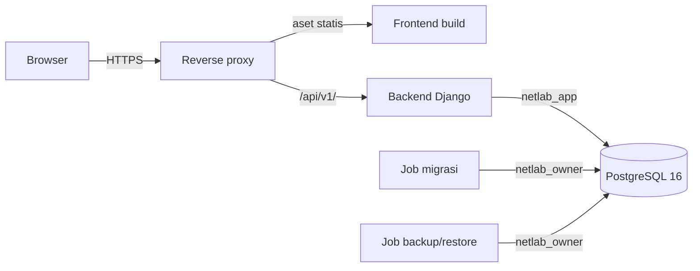

# NetLab Manager — Deployment

**Versi:** 1.2 (lingkungan akses ditetapkan: domain publik dan internet; DP-02 dan DP-03 tetap bersyarat)
**Tanggal:** 26 Oktober 2026
**Sumber:** `spec.md` v1.3 §14–15, `design.md` §12, `docs/DATA_MODEL.md` v1.2 (8.7, R-07), `docs/SECURITY.md`, `docs/VERSIONS.md`
**Status:** Dokumentasi saja. Tidak ada perintah atau konfigurasi di bawah yang pernah dijalankan. Perintah berfungsi sebagai ilustrasi urutan langkah, bukan skrip yang sudah diuji. Penanda **DP-xx** menunjuk keputusan; statusnya ada di bagian 11.

## 1. Prinsip

1. Deployment awal pada satu server Linux yang disetujui, memakai Compose.
2. PostgreSQL tidak pernah diekspos di luar jaringan internal.
3. Dua role database dipisahkan: pemilik skema untuk migrasi dan restore, runtime untuk aplikasi.
4. Volume data database tidak dihapus saat rebuild.
5. Secret tidak masuk Git atau log.
6. Backup tidak dianggap valid sebelum restore drill berhasil.

## 2. Topologi



Jaringan Compose:

| Jaringan | Anggota | Catatan |
| --- | --- | --- |
| `edge` | Reverse proxy | Satu-satunya yang memublikasikan port ke host (80 dan 443; lihat 7.2) |
| `app` | Reverse proxy, backend | Lalu lintas `/api/v1/` |
| `db` | Backend, job migrasi/backup, PostgreSQL | Internal; tanpa port ke host |

## 3. Layanan

| Layanan | Peran | Catatan |
| --- | --- | --- |
| Reverse proxy | HTTPS, routing, aset statis, header keamanan | Caddy (default, DP-01; Nginx alternatif); direktori data Caddy di volume persisten (7.1) |
| Backend | Django + application server | Server: gunicorn (VR-02); berjalan sebagai pengguna non-root; role `netlab_app` |
| Frontend | Build statis React yang disajikan proxy | Dibangun saat build image atau sebagai artefak; Node hanya untuk build |
| PostgreSQL 16 | Database | Volume persisten; hanya di jaringan `db` |
| Job migrasi | Menjalankan migrasi dengan role `netlab_owner` | Dijalankan eksplisit, bukan otomatis saat start aplikasi |
| Job backup/restore | `pg_dump`/`pg_restore` dengan role `netlab_owner` | Jadwal dan penyimpanan: DP-04 |

Setiap layanan memiliki health check dan kebijakan restart (bagian 10). Tag image dan varian dikunci pada Phase 0 (VERSIONS bagian 8); provider Compose: DP-02.

## 4. Konfigurasi

Konfigurasi lewat environment; nama final mengikuti implementasi (spec §15). Minimal:

| Variabel | Dipakai oleh | Rahasia | Catatan |
| --- | --- | --- | --- |
| `DJANGO_SECRET_KEY` | Backend | Ya | Berbeda per environment; mengganti membatalkan sesi |
| `DJANGO_DEBUG` | Backend | Tidak | `false` di production |
| `DJANGO_ALLOWED_HOSTS` | Backend | Tidak | Eksplisit |
| `CSRF_TRUSTED_ORIGINS` | Backend | Tidak | Eksplisit, https |
| `TIME_ZONE` | Backend | Tidak | `Asia/Jakarta` (DP-06) |
| `DATABASE_URL` | Backend runtime | Ya | Role `netlab_app` |
| `DATABASE_MIGRATION_URL` | Job migrasi | Ya | Role `netlab_owner`; tidak dipasang pada kontainer runtime |
| Batas rate limiting dan impor CSV | Backend | Tidak | Default dari spec §5 dan §8 |
| Kredensial bootstrap superuser/administrator | Prosedur bootstrap | Ya | Hanya saat first-run; dihapus setelahnya |
| Kunci enkripsi backup | Job backup | Ya | Alat: DP-04 |
| Kredensial superuser PostgreSQL | Inisialisasi cluster, DBA | Ya | Tidak dipakai aplikasi |

`.env.example` hanya berisi nilai contoh non-rahasia. Cara aplikasi memilih `DATABASE_MIGRATION_URL` untuk migrasi (variabel terpisah, perintah terpisah, atau berkas settings terpisah) ditentukan saat implementasi (DP-05).

## 5. First-run dan bootstrap

Urutan, masing-masing langkah dijalankan satu per satu dan diverifikasi sebelum lanjut:

1. **Inisialisasi PostgreSQL** pada volume baru. Akun superuser cluster hanya dipakai untuk langkah 2.
2. **Buat role dan database** (ilustrasi SQL, dijalankan DBA):

```sql
CREATE ROLE netlab_owner LOGIN PASSWORD '<dari secret store>';
CREATE ROLE netlab_app   LOGIN PASSWORD '<dari secret store>';
CREATE DATABASE netlab OWNER netlab_owner;
```

3. **Jalankan migrasi** sebagai `netlab_owner`. Urutan model: `AUTH_USER_MODEL = "accounts.User"` sudah ditetapkan sebelum migrasi pertama (DATA_MODEL bagian 9). Migrasi juga membuat trigger, fungsi `SECURITY DEFINER`, tabel klaim, dan grant (DATA_MODEL 8.7) dengan `RunSQL`.
4. **Pasang data awal:** Django Groups dan permission sesuai `RBAC_MATRIX.md` (data migration).
5. **Verifikasi grant** sebagai `netlab_app`: `DELETE` pada data operasional ditolak; `UPDATE` pada audit ditolak.
6. **Buat administrator pertama:** buat akun darurat satu kali, tetapkan peran `administrator`, wajib ganti password, lalu nonaktifkan atau simpan akun darurat sesuai kebijakan (SECURITY 11).
7. **Jalankan aplikasi** dengan `DATABASE_URL` role `netlab_app`, lalu periksa `GET /api/v1/health/`.

Belum diputuskan: apakah akun darurat dibuat lewat perintah manajemen Django atau skrip terpisah (DP-05).

## 6. Rilis dan migrasi

1. Backup terlebih dahulu (bagian 8) dan pastikan restore terakhir berhasil diuji.
2. Bangun image dengan pin yang sudah dikunci.
3. Jalankan job migrasi dengan role `netlab_owner`.
4. Mulai ulang backend dengan image baru; layanan database tidak dibangun ulang.
5. Periksa health check dan jalankan uji asap.
6. Rollback: restore dari backup; migrasi mundur hanya bila `reverse_sql` tersedia dan diuji.

Migrasi yang menambah tabel atau trigger memperbarui grant dalam migrasi yang sama (SECURITY 7).

## 7. Reverse proxy dan sertifikat

Persyaratan berikut independen dari produk (DP-01 memilih Caddy sebagai default; Nginx tetap alternatif bila server sudah punya standar Nginx):

1. Terminasi HTTPS dan meneruskan `/api/v1/` ke backend; selain itu menyajikan aset statis dengan fallback ke `index.html` untuk rute SPA.
2. Batas ukuran body minimal cukup untuk unggahan CSV 2 MB beserta overhead multipart; request lebih besar ditolak sebelum mencapai aplikasi.
3. Meneruskan skema (HTTPS) dan host asli melalui header yang dipercaya aplikasi; aplikasi hanya mempercayai header dari proxy ini.
4. Menyetel header keamanan SECURITY 8.3.
5. Timeout yang cukup untuk impor CSV; tidak ada cache pada respons API.
6. Log akses tidak memuat cookie, header autentikasi, atau body.
7. Tidak ada port database atau port internal lain yang dipublikasikan.

### 7.1 Caddy (DP-01)

1. Caddy menerima trafik pada port 80 dan 443; frontend disajikan sebagai berkas statis; `/api/v1/` diteruskan ke backend; backend dan PostgreSQL tidak memublikasikan port ke host.
2. Direktori data Caddy (sertifikat, kunci privat, akun ACME) berada di volume persisten dan tidak dihapus saat redeploy. Menghapusnya memicu permintaan sertifikat ulang dan dapat terkena batas laju CA (sumber sekunder).
3. Caddyfile belum ditulis dan belum diuji; versi dan tag image Caddy belum dipin (VERSIONS bagian 2).

### 7.2 Sertifikat HTTPS (DP-03, bersyarat)

Perilaku Caddy menurut dokumentasi resminya (caddyserver.com/docs/automatic-https, dibaca 26 Oktober 2026):

| Jenis nama | Sertifikat default |
| --- | --- |
| Nama DNS publik | Dari CA ACME publik (misalnya Let's Encrypt atau ZeroSSL) |
| Alamat IP dan hostname lokal/internal | Self-signed dari CA lokal Caddy; tanpa ACME dan tanpa validasi DNS |

Tantangan ACME: HTTP-01 membutuhkan port 80 dapat dijangkau dari luar; TLS-ALPN-01 membutuhkan port 443 dapat dijangkau dari luar; DNS-01 membutuhkan konfigurasi tambahan dan, bila diaktifkan, menonaktifkan tantangan lain secara default. Sumber sekunder menyebut DNS-01 umumnya membutuhkan modul penyedia DNS (build Caddy kustom) dan kredensial API DNS; hal itu belum diverifikasi pada dokumentasi resmi.

Keputusan DP-03 bersyarat pada hasil konfirmasi administrator (7.3):

| Kondisi | Jalur |
| --- | --- |
| A. Domain publik; DNS `A`/`AAAA` mengarah ke server; port 80/443 terjangkau; trafik masuk diizinkan | **ACME otomatis oleh Caddy** (HTTP-01 atau TLS-ALPN-01). **Jalur default DP-03**, sesuai lingkungan yang ditetapkan. |
| B. Domain publik, tetapi server tidak dapat dijangkau dari internet | ACME **DNS-01**: butuh kendali DNS, modul DNS pada build Caddy, dan secret baru (kredensial API DNS). |
| C. Hanya jaringan internal, tanpa domain publik | **Bukan** ACME publik: sertifikat dari CA internal lab (direktif `tls` dengan sertifikat dan kunci), atau CA lokal Caddy (`tls internal`) dengan root CA dipercaya di setiap klien. Keduanya membutuhkan pengelolaan kepercayaan klien. |
| D. Tidak ada satu pun kondisi terpenuhi | **Blocker:** deployment produksi tidak dijalankan. |

Lingkungan akses yang ditetapkan pemilik proyek (27 Oktober 2026) adalah **domain publik dengan akses internet**. Karena itu jalur A adalah default, jalur B hanya dipakai bila port validasi tidak terjangkau dari internet, dan jalur C dan D tidak berlaku kecuali lingkungan berubah.

Aturan: deployment produksi **tidak boleh** diturunkan menjadi HTTP tanpa TLS. Pengembangan lokal di komputer sendiri bukan deployment produksi. Kebijakan HSTS (SECURITY SD-04) menunggu jalur dipilih dan HTTPS terbukti stabil.

### 7.3 Konfirmasi administrator (prasyarat deployment)

1. Domain tersedia dan boleh dipakai untuk NetLab Manager (publik atau internal).
2. DNS `A`/`AAAA` mengarah ke server yang benar (rekaman `AAAA` salah dapat menggagalkan validasi).
3. Port 80 dan/atau 443 dapat dijangkau untuk validasi ACME, atau kendali DNS tersedia untuk DNS-01.
4. Administrator mengizinkan trafik masuk dan konfigurasi reverse proxy; tidak ada layanan lain yang memakai port 80/443.
5. Hanya bila jalur A tidak dapat dipenuhi dan lingkungan berubah menjadi jaringan internal: tersedia CA internal, atau disetujui memakai CA lokal Caddy beserta distribusi root CA ke klien.

Lingkungan akses sudah ditetapkan (domain publik dan internet), sehingga jalur A menjadi default. Yang masih perlu dikonfirmasi administrator: (a) ketersediaan dan pengelolaan DNS untuk domain tersebut, (b) rekaman `A`/`AAAA` mengarah ke server, (c) keterjangkauan port validasi dari internet (80 untuk HTTP-01 dan/atau 443 untuk TLS-ALPN-01), dan (d) izin trafik masuk (butir 4).

## 8. Backup dan restore

### 8.1 Backup

1. Dump logis seluruh database oleh `netlab_owner` (format kustom `pg_dump` diusulkan).
2. Backup harian dan sebelum setiap rilis, terenkripsi, dengan salinan di luar host dan retensi awal 14 hari (DP-04, disetujui). Alat, lokasi salinan di luar host, dan pemantauan keberhasilan belum ditentukan.
3. Backup memuat audit dan hash password; akses dibatasi (SECURITY 9).
4. Backup dibuat sebelum setiap rilis (bagian 6).

### 8.2 Restore drill (wajib sebelum Phase 5)

Restore diuji ke database kosong yang terpisah dari production. Setelah restore, verifikasi (ilustrasi pemeriksaan, belum pernah dijalankan):

1. Jumlah baris tiap tabel sesuai sumber.
2. Seluruh trigger dan fungsi ada: trigger penjaga (DATA_MODEL 8.5), `*_append_only`, `*_no_truncate`, dan `connections_connection_sync_claims`.
3. Tabel klaim konsisten: setiap koneksi aktif bertipe fisik memiliki dua klaim, dan tidak ada klaim tanpa koneksi aktif fisik yang cocok.
4. Grant role runtime sesuai DATA_MODEL 8.7 (peran dan hak dipasang ulang bila restore hanya mengembalikan data).
5. Sebagai `netlab_app`: `DELETE` ditolak, `UPDATE` audit ditolak, penulisan tabel klaim ditolak.
6. Aplikasi dapat login dan `health` melaporkan `ok`.
7. Pengujian append-only: percobaan `UPDATE` pada audit gagal.

Risiko DATA_MODEL R-07 (backup/restore terhadap trigger, fungsi `SECURITY DEFINER`, dan tabel klaim belum diuji) tetap terbuka sampai drill ini berhasil.

## 9. Aturan rebuild dan pemeliharaan

1. **Jangan menghapus volume database** saat rebuild atau redeploy. Perintah yang menghapus volume (misalnya `down` dengan opsi hapus volume) dilarang pada environment dengan data.
2. Minor PostgreSQL diterapkan setelah backup dan membaca catatan rilis; mayor memerlukan rencana terpisah dan ADR.
3. Pembaruan dependency mengikuti `docs/VERSIONS.md`; pin tidak diubah tanpa memperbarui dokumen dan ADR-021.
4. Pantau dukungan: Django 5.2 sampai April 2028 dan PostgreSQL 16 sampai November 2028 (VERSIONS bagian 2).

## 10. Health check dan observabilitas minimal

| Layanan | Pemeriksaan |
| --- | --- |
| PostgreSQL | Kesiapan menerima koneksi |
| Backend | `GET /api/v1/health/` (200 dengan `{"status":"ok"}` bila aplikasi dan database berfungsi; 503 bila tidak) |
| Reverse proxy | Respons pada rute statis |

Log aplikasi ke keluaran standar kontainer dengan aturan SECURITY 6. Monitoring real-time di luar cakupan MVP (PRD §5).

## 11. Keputusan dan statusnya

Status per 26 Oktober 2026.

| ID | Keputusan | Status dan syarat |
| --- | --- | --- |
| DP-01 | Caddy sebagai reverse proxy default; Nginx alternatif jika diwajibkan standar server lab. | Disetujui (dikonfirmasi 27 Oktober 2026). |
| DP-02 | Docker Compose bila tersedia dan lolos uji pada server target; bila tidak, evaluasi Podman Compose. | Disetujui bersyarat; server target belum diperiksa. |
| DP-03 | HTTPS lewat ACME dengan sertifikat publik yang dikelola Caddy. | **Bersyarat.** Lingkungan ditetapkan: domain publik dan internet (jalur A default). Menunggu konfirmasi administrator: DNS, arah rekaman ke server, dan keterjangkauan port validasi (7.3). Bila tidak terpenuhi: jalur B (atau D); tidak pernah HTTP tanpa TLS. |
| DP-04 | Backup harian dan sebelum rilis, terenkripsi, salinan di luar host, retensi awal 14 hari; wajib restore drill. | Disetujui; alat dan lokasi salinan belum ditentukan. |
| DP-05 | Variabel lingkungan terpisah per job untuk URL migrasi; akun darurat lewat perintah manajemen Django. | Default diterima. |
| DP-06 | `TIME_ZONE = Asia/Jakarta`. | Disetujui. |
| DP-07 | Image resmi dengan tag eksak dan digest; build lokal. | Default diterima; tag belum ditentukan. |

## 12. Belum divalidasi

- Seluruh topologi, jaringan, dan urutan first-run (tidak pernah dijalankan).
- Provider Compose yang tersedia pada server target.
- Seluruh jalur sertifikat DP-03; DNS, arah rekaman, dan keterjangkauan port validasi belum dikonfirmasi administrator (lingkungan akses sudah ditetapkan: domain publik dan internet).
- Caddyfile dan versi Caddy (belum ditulis dan belum dipin).
- Persistensi direktori data Caddy antar-redeploy.
- Restore drill dan R-07.
- Header keamanan terhadap hasil build frontend.
- Trigger dan DDL sebagai migrasi `RunSQL` Django (DDL sudah diuji ulang setelah `vlan_number`, DATA_MODEL 16.7).

## 13. Catatan revisi

**1.2:** lingkungan akses ditetapkan (domain publik, internet); jalur A menjadi default DP-03; sisa konfirmasi administrator dipersempit ke DNS, arah rekaman, dan port validasi; kalimat "cara akses belum dijawab" dihapus.

**1.1:** DP-01 s.d. DP-07 diputuskan (DP-02 dan DP-03 bersyarat); menambah 7.1–7.3 (Caddy, jalur sertifikat, konfirmasi administrator).

**1.0:** dokumen awal.
